# LỜI MỞ ĐẦU

Trong hoạt động hằng ngày, nhà hàng hải sản phải đồng thời xử lý nhiều nghiệp vụ liên kết chặt chẽ với nhau như tiếp nhận đặt bàn, quản lý tình trạng bàn ăn, cập nhật thực đơn theo thời giá, lập và điều chỉnh hóa đơn, ghi nhận thanh toán và nhập nguyên liệu từ nhà cung cấp. Nếu các thông tin này được ghi chép rời rạc hoặc thiếu ràng buộc, nhân viên rất dễ gặp sai sót khi đối chiếu bàn trống, đơn giá tại thời điểm bán hay số lượng tồn kho sau khi chỉnh sửa chứng từ.

Đề tài “Hệ thống quản lý nhà hàng hải sản” được nhóm 4 thực hiện nhằm vận dụng phương pháp Phân tích và thiết kế hướng đối tượng (OOAD) để đi từ bài toán nghiệp vụ thực tế đến mô hình phân tích, mô hình thiết kế, cài đặt ứng dụng web nội bộ bằng Java Spring Boot – Thymeleaf – Oracle và kiểm thử tính đúng đắn của các quy tắc trọng tâm. Ba nghiệp vụ được phân tích sâu gồm lập và điều chỉnh hóa đơn, ghi nhận thanh toán và lập hoặc điều chỉnh phiếu nhập kho; nghiệp vụ đặt bàn và phân quyền tài khoản được đối chiếu chi tiết để làm rõ vòng đời trạng thái cùng các giới hạn hiện tại.

Nội dung báo cáo được tổ chức thành 4 chương: Chương 1 trình bày bài toán, phạm vi, quy tắc nghiệp vụ và đặc tả các ca sử dụng; Chương 2 xây dựng mô hình phân tích gồm biểu đồ lớp khái niệm, bảng trách nhiệm CRC, biểu đồ tuần tự hệ thống (SSD) và hợp đồng thao tác; Chương 3 trình bày thiết kế kiến trúc, biểu đồ tuần tự thiết kế, biểu đồ lớp thiết kế (DCD), máy trạng thái và thiết kế cơ sở dữ liệu (ERD); Chương 4 trình bày kết quả cài đặt và kiểm thử thực nghiệm.

# MỤC LỤC

# DANH MỤC HÌNH VẼ

# DANH MỤC BẢNG BIỂU

# DANH MỤC TỪ VIẾT TẮT

Bảng dưới đây tổng hợp các ký hiệu và thuật ngữ viết tắt được sử dụng thống nhất trong toàn bộ tài liệu và các sơ đồ mô hình hóa.

*Bảng M.1. Danh mục thuật ngữ và từ viết tắt*

| Ký hiệu / Từ viết tắt | Ý nghĩa đầy đủ |
| --- | --- |
| OOAD | Object-Oriented Analysis and Design – Phân tích và thiết kế hướng đối tượng. |
| UML | Unified Modeling Language – Ngôn ngữ mô hình hóa thống nhất. |
| UC / Actor | Use Case (ca sử dụng) / Tác nhân tương tác với hệ thống. |
| CRC | Class – Responsibility – Collaborator (Lớp – Trách nhiệm – Cộng tác). |
| SSD / SD | System Sequence Diagram (Biểu đồ tuần tự hệ thống) / Sequence Diagram (Biểu đồ tuần tự thiết kế). |
| DCD | Design Class Diagram – Biểu đồ lớp thiết kế. |
| ERD | Entity-Relationship Diagram – Biểu đồ thực thể liên kết. |
| BCE | Boundary – Control – Entity (Biên – Điều khiển – Thực thể). |
| DTO | Data Transfer Object – Đối tượng truyền dữ liệu biểu mẫu. |
| PK / FK / UQ | Primary Key (Khóa chính) / Foreign Key (Khóa ngoại) / Unique Constraint (Ràng buộc duy nhất). |
| NFR / BR | Non-Functional Requirement (Yêu cầu phi chức năng) / Business Rule (Quy tắc nghiệp vụ). |
| JPA / CSRF | Jakarta Persistence API / Cross-Site Request Forgery (Giả mạo yêu cầu liên trang). |

# CHƯƠNG 1. BÀI TOÁN VÀ PHÂN TÍCH YÊU CẦU

## 1.1. Bài toán, mục tiêu và bối cảnh

### 1.1.1. Đặt vấn đề và bối cảnh nghiệp vụ

Nhà hàng hải sản cần quản lý xuyên suốt từ khâu tiếp nhận đặt bàn của khách, theo dõi tình trạng sử dụng bàn ăn, quản lý danh mục loại món và món ăn, lập hóa đơn phục vụ, xác nhận món và thu tiền, đến quản lý nhà cung cấp, nguyên liệu và phiếu nhập kho. Thực tế kinh doanh hải sản có đặc thù tính giá bán theo nhiều đơn vị (kg, con, đĩa), giá món có thể biến động theo ngày, trong khi hóa đơn cũ đã lập và đã thanh toán vẫn phải giữ nguyên giá trị lịch sử để đối chiếu doanh thu.

Bài toán đặt ra các vấn đề nghiệp vụ vượt khỏi thao tác thêm, sửa, xóa dữ liệu thông thường: (1) Nếu cùng một món được gọi thêm nhiều lần trên một hóa đơn thì phải cộng dồn số lượng vào một dòng duy nhất thay vì tạo dòng trùng lặp, đồng thời phải kiểm soát phần số lượng đã xác nhận bếp để thu ngân không tự ý giảm hoặc xóa; (2) Khi sửa hoặc xóa một phiếu nhập đã làm tăng tồn kho, hệ thống phải tính lại phần chênh lệch (lượng mới trừ lượng cũ) và khóa chống ghi đè khi người dùng gửi biểu mẫu cũ; (3) Hóa đơn đã thanh toán phải được khóa tuyệt đối khỏi việc chỉnh sửa hoặc thanh toán lặp lại để bảo vệ số liệu báo cáo doanh thu.

### 1.1.2. Mục tiêu của đề tài

*Bảng 1.1. Mục tiêu của đề tài và cách đánh giá*

| Mã | Mục tiêu | Tiêu chí đánh giá |
| --- | --- | --- |
| MT01 | Quản lý khách hàng, bàn ăn và lượt đặt bàn nhất quán | Phân biệt rõ trạng thái lượt đặt (CHO_XAC_NHAN, DA_XAC_NHAN, DA_HUY, HOAN_THANH) với trạng thái bàn (Trống, Đã đặt, Đang dùng); quy định điều kiện chuyển trạng thái. |
| MT02 | Ghi nhận bán hàng, xác nhận món và thanh toán chính xác | Hóa đơn có chi tiết gồm số lượng, số lượng đã xác nhận, đơn giá lấy từ máy chủ; tổng tiền tính tại server; khóa chứng từ sau thanh toán và giải phóng bàn phù hợp. |
| MT03 | Quản lý nhập hàng gắn chặt với tồn kho | Lập, sửa, xóa phiếu nhập cập nhật tồn nguyên liệu trong cùng giao dịch; khóa bi quan và kiểm tra phiên bản chống xung đột form cũ. |
| MT04 | Truy vết nhất quán từ phân tích đến cài đặt và kiểm thử | Use Case, mô hình khái niệm, CRC, Sequence Diagram, DCD, State Machine, mã nguồn Java Spring Boot và test case dùng chung tên gọi, quy tắc và điều kiện. |

## 1.2. Phạm vi và các giả định

### 1.2.1. Phạm vi hệ thống

Hệ thống được xây dựng dưới dạng ứng dụng web quản lý nội bộ cho một cơ sở nhà hàng hải sản, sử dụng Java Spring Boot, Thymeleaf và cơ sở dữ liệu Oracle. Việc xác định rõ ranh giới phạm vi giúp mô hình tập trung vào các quy trình cốt lõi thay vì mở rộng dàn trải các phân hệ ngoài nhu cầu.

*Bảng 1.2. Phạm vi thực hiện và nội dung ngoài phạm vi*

| Trong phạm vi thực hiện | Ngoài phạm vi phiên bản hiện tại |
| --- | --- |
| Quản lý khách hàng, bàn ăn; tiếp nhận, xác nhận, hủy và hoàn thành lượt đặt bàn. | Khách hàng tự đặt bàn trực tuyến qua cổng công khai; sơ đồ ghép/tách nhiều bàn; đặt lịch chi tiết theo từng khung giờ. |
| Quản lý loại món, món ăn (đơn vị, đơn giá, URL ảnh, mô tả, trạng thái) và hồ sơ nhân viên. | Tải tệp ảnh trực tiếp lên máy chủ; hệ thống chấm công và tính lương tự động theo ca làm việc. |
| Lập/sửa hóa đơn chưa thanh toán, gộp món trùng, xác nhận món, giảm tiền trực tiếp, ghi nhận thanh toán và giải phóng bàn. | Tách hoặc gộp hóa đơn; thanh toán nhiều đợt; kết nối cổng thanh toán ngân hàng/QR; hoàn tiền và xuất hóa đơn điện tử. |
| Quản lý nhà cung cấp, nguyên liệu, lập/sửa/xóa phiếu nhập và điều chỉnh tồn kho theo chênh lệch. | Phiếu xuất bếp, kiểm kê định kỳ, công thức định lượng món – nguyên liệu để tự động trừ tồn khi bán món. |
| Đăng nhập bằng tài khoản được cấp; quản trị tài khoản và phân quyền 4 vai trò (ADMIN, THU_NGAN, QUAN_LY_KHO, KE_TOAN); xem báo cáo doanh thu. | Tự đăng ký tài khoản công khai; cơ chế khôi phục mật khẩu qua email; liên kết bắt buộc 1–1 giữa tài khoản đăng nhập và hồ sơ nhân sự. |

### 1.2.2. Các giả định nghiệp vụ xuyên suốt

*Bảng 1.3. Các giả định nghiệp vụ sử dụng xuyên suốt báo cáo*

| Mã | Giả định và hệ quả thiết kế |
| --- | --- |
| G01 | Hệ thống phục vụ một cơ sở nhà hàng duy nhất; đơn vị tiền tệ là VNĐ. Số lượng món bán và nguyên liệu nhập hỗ trợ số thập phân (NUMBER(10,2)) vì hải sản thường cân theo kg. |
| G02 | Mỗi hóa đơn gắn với một bàn ăn và một nhân viên lập chứng từ; khách hàng là tùy chọn (nullable) để phục vụ cả khách vãng lai không cần lưu hồ sơ. |
| G03 | Giảm giá trên hóa đơn là số tiền giảm trừ trực tiếp, không phải tỷ lệ phần trăm. Tiền cọc đặt bàn được lưu độc lập trên phiếu đặt bàn, chưa tự động bù trừ vào hóa đơn khi thanh toán. |
| G04 | Lượt đặt bàn hiện lưu theo ngày (LocalDate) và kiểm tra theo trạng thái toàn cục của bàn (“Trống” / “Đã đặt” / “Đang dùng”); chưa kiểm tra trùng lịch theo khung giờ cụ thể. |
| G05 | Mỗi phiếu nhập thuộc một nhà cung cấp và một nhân viên lập; mỗi nguyên liệu chỉ xuất hiện tối đa một dòng trong cùng phiếu. Tồn kho ban đầu có thể khai báo khi tạo nguyên liệu. |
| G06 | Phục vụ, Thu ngân, Thủ kho và Quản lý là các vai trò ở mức phân tích nghiệp vụ. Khi cài đặt phân quyền website, hệ thống ánh xạ sang 4 vai trò kỹ thuật trong TAI_KHOAN.VAI_TRO: ADMIN, THU_NGAN (đảm nhiệm cả nghiệp vụ phục vụ bàn và thu ngân), QUAN_LY_KHO và KE_TOAN. |

## 1.3. Quy tắc nghiệp vụ

Các quy tắc nghiệp vụ dưới đây chi phối tính toàn vẹn dữ liệu giữa các phân hệ. Cột mức đáp ứng phản ánh trung thực kết quả đối chiếu trực tiếp trên mã nguồn hiện tại.

*Bảng 1.4. Các quy tắc nghiệp vụ cốt lõi và mức đáp ứng trong mã nguồn*

| Mã | Quy tắc nghiệp vụ | Mức đáp ứng khi đối chiếu mã nguồn |
| --- | --- | --- |
| BR01 | Chỉ tiếp nhận lượt đặt bàn mới khi bàn ở trạng thái “Trống”; số khách không vượt quá sức chứa bàn. | DatBanController đã kiểm tra bàn “Trống” trước khi lưu và đổi bàn sang “Đã đặt”; cần bổ sung kiểm tra số người so với sức chứa và khóa đồng thời. |
| BR02 | Hủy hoặc hoàn thành lượt đặt bàn trả bàn về “Trống”; trạng thái kết thúc không được mở lại tùy ý. | DatBanService.huyDatBan/hoanThanh cập nhật trạng thái bàn về “Trống”; cần bổ sung guard kiểm tra trạng thái nguồn hợp lệ. |
| BR03 | Hóa đơn mới chỉ được tạo trên bàn “Trống” và chưa có hóa đơn mở; phải có người lập, ít nhất một món và số lượng dương. | HoaDonService.taoHoaDon kiểm tra bàn “Trống”, kiểm tra chưa có hóa đơn “Chua thanh toan”, kiểm tra danh sách/lượng và tự chuyển bàn sang “Đang dùng”. |
| BR04 | Các dòng cùng món trong một hóa đơn được cộng dồn số lượng; lượng món đã xác nhận phải được bảo vệ. | HoaDonService gộp bằng LinkedHashMap; phương thức xacNhanMon() chốt SO_LUONG_DA_XAC_NHAN và chặn ROLE_THU_NGAN giảm hoặc xóa dưới mức đã xác nhận. |
| BR05 | Đơn giá bán do server lấy từ danh mục MON_AN tại thời điểm ghi; thành tiền = số lượng × đơn giá; tổng hóa đơn = max(0, tổng chi tiết − giảm giá). | Xử lý hoàn toàn ở HoaDonService bằng BigDecimal; giảm giá âm bị từ chối. |
| BR06 | Hóa đơn đã thanh toán không được sửa, xóa hoặc thanh toán lại; thanh toán hoặc xóa hóa đơn trả bàn về “Trống” nếu hết hóa đơn mở. | HoaDonService kiểm tra trạng thái “Da thanh toan” và gọi capNhatTrangThaiBanNeuKhongConHoaDonChuaThanhToan() trong @Transactional; cần bổ sung khóa chống thanh toán đồng thời. |
| BR07 | Phiếu nhập không được lặp nguyên liệu; số lượng nhập > 0 và đơn giá nhập ≥ 0. | Kiểm tra hai tầng bằng Jakarta Validation ở PhieuNhapForm/DongNhapForm và kiểm tra trùng mã trong PhieuNhapService. |
| BR08 | Sửa phiếu nhập điều chỉnh tồn theo chênh lệch (mới − cũ); xóa phiếu hoàn lại lượng đã nhập; từ chối nếu tồn âm hoặc vượt ngưỡng. | PhieuNhapService khóa nguyên liệu theo thứ tự mã tăng dần, kiểm tra nguyên liệu ngừng hoạt động và kiểm tra giới hạn tồn NUMBER(10,2). |
| BR09 | Thao tác chứng từ nhiều bảng phải thành công trọn vẹn hoặc rollback toàn bộ khi có lỗi. | HoaDonService và PhieuNhapService dùng @Transactional; luồng tiếp nhận đặt bàn ở DatBanController hiện lưu tách bước với BanAnService. |
| BR10 | Biểu mẫu sửa/xóa phiếu nhập cũ không được ghi đè phiên bản mới hơn đã lưu. | PhieuNhap có cột PHIEN_BAN (@Version); Service kiểm tra khớp phiên bản và khóa PESSIMISTIC_FORCE_INCREMENT. |
| BR11 | Không cho phép xóa loại món đang có món, món đã nằm trong hóa đơn hoặc nhân viên đã lập chứng từ. | LoaiMonService, MonAnService và NhanVienService kiểm tra tham chiếu trước khi xóa và gợi ý đổi trạng thái. |
| BR12 | Doanh thu chỉ cộng TONG_TIEN của hóa đơn “Da thanh toan” trong khoảng ngày hợp lệ (ngày kết thúc ≥ ngày bắt đầu). | BaoCaoService kiểm tra khoảng ngày và lọc theo trạng thái “Da thanh toan”; thống kê món bán chạy hiện tổng hợp toàn kỳ. |

## 1.4. Tác nhân và mục tiêu người dùng

Ở giai đoạn phân tích yêu cầu, hệ thống xác định một tác nhân khái quát là Nhân viên nội bộ cùng bốn vai trò tác nhân nghiệp vụ chuyên biệt. Khách hàng và nhà cung cấp là các đối tượng được quản lý thông tin gián tiếp thông qua nhân viên, chưa có cổng đăng nhập trực tiếp nên không xuất hiện làm tác nhân trên biểu đồ Use Case nội bộ.

*Bảng 1.5. Tác nhân nghiệp vụ, mục tiêu và ánh xạ sang vai trò cài đặt*

| Tác nhân | Mục tiêu nghiệp vụ | UC liên quan | Ánh xạ vai trò tài khoản |
| --- | --- | --- | --- |
| Nhân viên nội bộ | Đăng nhập bằng tài khoản được cấp và đăng xuất an toàn khi kết thúc ca. | UC01 | Lớp cha chung cho cả 4 vai trò (ADMIN, THU_NGAN, QUAN_LY_KHO, KE_TOAN). |
| Phục vụ | Tra cứu khách hàng, kiểm tra bàn trống và tiếp nhận/xử lý lượt đặt bàn. | UC03, UC10 | Gộp chung trong quyền THU_NGAN trên ứng dụng web. |
| Thu ngân | Lập hóa đơn, thêm/xác nhận món, điều chỉnh hóa đơn mở và ghi nhận thanh toán. | UC04, UC05 | Vai trò THU_NGAN (tương thích ngược các tài khoản cũ ghi NHAN_VIEN). |
| Thủ kho | Quản lý danh mục nhà cung cấp, nguyên liệu và lập/sửa/xóa phiếu nhập kho. | UC06, UC09 | Vai trò QUAN_LY_KHO. |
| Quản lý | Quản lý thực đơn, nhân sự, tài khoản/phân quyền và theo dõi báo cáo doanh thu. | UC02, UC07, UC08, UC11 | Vai trò ADMIN toàn quyền (riêng UC07 xem báo cáo mở thêm cho KE_TOAN). |

### 1.4.1. Quan hệ tác nhân – ca sử dụng và cơ chế phân quyền thực tế

Quan hệ tổng quát hóa giữa các tác nhân chuyên biệt và Nhân viên nội bộ biểu thị rằng mọi vai trò đều thực hiện được UC01 (Đăng nhập / đăng xuất). Vì đăng nhập là tiền điều kiện chung cho các nghiệp vụ nội bộ, biểu đồ Use Case không vẽ đường <<include>> lặp lại từ mọi ca sử dụng về UC01. Tương tự, việc lập hóa đơn (UC04) và thanh toán (UC05) được tách thành hai ca sử dụng độc lập vì hóa đơn phục vụ tại bàn có thể kéo dài và chỉnh sửa nhiều lần trước khi thu ngân thực hiện thanh toán.

Về mặt cài đặt bảo mật, SecurityConfig kiểm soát quyền truy cập URL dựa trên cột VAI_TRO trong bảng TAI_KHOAN với bốn giá trị hợp lệ: ADMIN, THU_NGAN, QUAN_LY_KHO và KE_TOAN. Trong lớp TaiKhoanService.NguoiDung, giá trị cũ QUAN_LY được tự động quy đổi thành ADMIN và NHAN_VIEN được quy đổi thành THU_NGAN để tương thích dữ liệu cũ. Thông tin chức vụ trong bảng NHAN_VIEN chỉ phục vụ hồ sơ nhân sự, chưa liên kết khóa ngoại trực tiếp với TAI_KHOAN.

## 1.5. Biểu đồ Use Case tổng quát

Hình 1.1 mô tả ranh giới ứng dụng quản lý nội bộ cùng 11 ca sử dụng phục vụ các tác nhân nghiệp vụ. Đường biên hình chữ nhật thể hiện phạm vi xử lý của phần mềm.

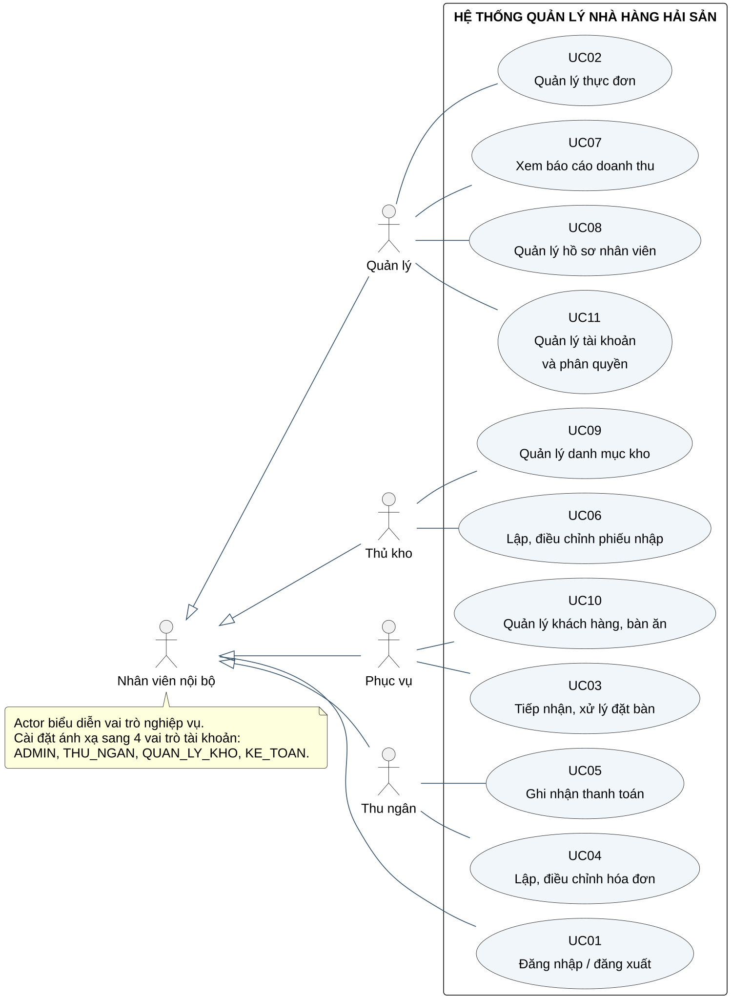

Biểu đồ không bổ sung tác nhân Khách đặt bàn trực tuyến, Ngân hàng hay Hệ thống bếp vì các tích hợp này không nằm trong phạm vi thiết kế của phiên bản hiện tại.

## 1.6. Danh sách ca sử dụng

*Bảng 1.6. Danh sách 11 ca sử dụng của hệ thống*

| Mã UC | Tên ca sử dụng | Kết quả nghiệp vụ chính |
| --- | --- | --- |
| UC01 | Đăng nhập / đăng xuất | Xác thực tài khoản được cấp bằng BCrypt, tạo phiên làm việc theo vai trò hoặc hủy phiên khi đăng xuất. |
| UC02 | Quản lý thực đơn | Thêm, sửa, tìm kiếm, lọc loại món và món ăn; chặn xóa loại đang có món hoặc món đã phát sinh hóa đơn. |
| UC03 | Tiếp nhận, xử lý đặt bàn | Tạo lượt đặt cho bàn trống, xác nhận, hủy hoặc hoàn thành; đồng bộ trạng thái bàn ăn. |
| UC04 | Lập, điều chỉnh hóa đơn | Tạo hoặc sửa hóa đơn chưa thanh toán, gộp món trùng, chốt món đã xác nhận và tính tổng tiền tại server. |
| UC05 | Ghi nhận thanh toán | Kiểm tra hóa đơn có món và chưa thanh toán, tính lại tổng, chuyển sang Da thanh toan và giải phóng bàn. |
| UC06 | Lập, điều chỉnh phiếu nhập | Tạo, sửa, xóa phiếu nhập và chi tiết; cập nhật tồn kho theo chênh lệch trong cùng giao dịch có khóa phiên bản. |
| UC07 | Xem báo cáo doanh thu | Tổng hợp doanh thu hóa đơn đã thanh toán theo khoảng ngày, hôm nay, tháng hiện tại và thống kê món bán chạy. |
| UC08 | Quản lý hồ sơ nhân viên | Thêm, sửa, lọc hồ sơ nhân sự, chức vụ, ca làm, mức lương; bảo vệ nhân viên đã lập chứng từ khi xóa. |
| UC09 | Quản lý danh mục kho | Thêm, sửa, xóa nhà cung cấp và nguyên liệu; bảo vệ dữ liệu đang được phiếu nhập tham chiếu. |
| UC10 | Quản lý khách hàng, bàn ăn | Tra cứu, thêm, sửa, xóa hồ sơ khách hàng và danh mục bàn ăn (số chỗ, khu vực, trạng thái). |
| UC11 | Quản lý tài khoản, phân quyền | Quản trị viên (ADMIN) xem danh sách và cấp tài khoản đăng nhập mới với một trong 4 vai trò chuẩn. |

### 1.6.1. Lý do lựa chọn các ca sử dụng phân tích sâu

Nhóm tập trung phân tích và thiết kế chi tiết các ca sử dụng có quy tắc nghiệp vụ phức tạp và ảnh hưởng trực tiếp đến tính đúng đắn dữ liệu: UC03 (vòng đời trạng thái đặt bàn và giữ bàn), UC04 (khóa ghép, đơn giá lịch sử, xác nhận món và tính tổng tiền), UC05 (điều kiện khóa chứng từ và giải phóng bàn) và UC06 (giao dịch đa bảng, điều chỉnh tồn kho theo chênh lệch và xử lý xung đột phiên bản). Các ca sử dụng UC01, UC07 và UC11 được đặc tả để làm rõ cơ chế bảo mật và cách tổng hợp số liệu; các ca sử dụng danh mục UC02, UC08, UC09, UC10 được trình bày ở mức tóm tắt kèm ràng buộc bảo vệ xóa.

## 1.7. Đặc tả các ca sử dụng tiêu biểu

### 1.7.1. UC01 – Đăng nhập / đăng xuất và UC11 – Quản lý tài khoản

*Bảng 1.7. Đặc tả ca sử dụng UC01 – Đăng nhập / đăng xuất*

| Thành phần | Nội dung đặc tả |
| --- | --- |
| Tác nhân, mục tiêu | Nhân viên nội bộ (thuộc một trong 4 vai trò); xác thực để sử dụng chức năng theo quyền được cấp. |
| Tiền điều kiện | Tồn tại bản ghi trong TAI_KHOAN với mật khẩu đã băm BCrypt (độ khó 12); kết nối cơ sở dữ liệu hoạt động. |
| Luồng chính | 1. Người dùng mở /login. 2. Nhập tên đăng nhập (tenDangNhap) và mật khẩu (matKhau). 3. Hệ thống chuẩn hóa tên đăng nhập, tải tài khoản và đối chiếu BCrypt. 4. Tạo phiên xác thực kèm quyền ROLE_* và chuyển về trang chủ (/). 5. Khi đăng xuất (/logout), hủy phiên và xóa cookie JSESSIONID. |
| Thay thế / ngoại lệ | Sai thông tin đăng nhập: chuyển /login?error và không cấp phiên. Chưa đăng nhập truy cập URL nghiệp vụ: chuyển tới /login. Đã đăng nhập truy cập /login: chuyển về trang chủ. Truy cập URL vượt quyền vai trò: trả HTTP 403. Không hỗ trợ tự đăng ký (/register). |
| Hậu điều kiện | Thành công: phiên làm việc gắn đúng vai trò được thiết lập. Thất bại: không có phiên mới; đăng xuất: phiên cũ mất hiệu lực. |

*Bảng 1.8. Đặc tả rút gọn UC11 – Quản lý tài khoản và phân quyền*

| Thành phần | Nội dung đặc tả |
| --- | --- |
| Tác nhân / tiền điều kiện | Quản lý (ADMIN); đã đăng nhập tại /tai-khoan. |
| Luồng chính | Xem danh sách tài khoản hiện có; nhập họ tên (1–100 ký tự), tên đăng nhập ([a-z0-9_], 3–30 ký tự), mật khẩu (8–72 byte UTF-8) và vai trò (ADMIN, THU_NGAN, QUAN_LY_KHO, KE_TOAN); hệ thống băm mật khẩu bằng BCrypt và lưu vào TAI_KHOAN. |
| Ngoại lệ / hậu điều kiện | Trùng tên đăng nhập, sai định dạng hoặc vai trò không hợp lệ: từ chối lưu và hiển thị thông báo lỗi. Thành công: tài khoản mới sẵn sàng đăng nhập ngay. |

### 1.7.2. UC02 – Quản lý thực đơn

*Bảng 1.9. Đặc tả rút gọn UC02 – Quản lý thực đơn*

| Thành phần | Nội dung đặc tả |
| --- | --- |
| Tác nhân / tiền điều kiện | Quản lý (ADMIN); đã đăng nhập (SecurityConfig giới hạn /loai-mon/** và /mon-an/** cho ROLE_ADMIN). |
| Luồng chính | Xem danh sách loại món (kèm số lượng món đếm bằng GROUP BY) hoặc danh sách món ăn dạng thẻ/bảng; nhập hoặc cập nhật tên, loại món, đơn vị, đơn giá, URL ảnh (HTTP/HTTPS), mô tả và trạng thái; kiểm tra @Valid qua LoaiMonForm/MonAnForm và lưu. |
| Thay thế / ngoại lệ | Dữ liệu sai định dạng hoặc mã loại không tồn tại: trả lại biểu mẫu kèm thông báo lỗi và giữ lại dữ liệu đã nhập. Xóa loại đang có món hoặc món đã nằm trong CT_HOA_DON: từ chối xóa để bảo toàn lịch sử chứng từ. |
| Hậu điều kiện | Danh mục thực đơn được cập nhật; thay đổi giá món trong danh mục không tự sửa đơn giá của các hóa đơn đã lập trước đó. |

### 1.7.3. UC03 – Tiếp nhận, xử lý đặt bàn

*Bảng 1.10. Đặc tả ca sử dụng UC03 – Tiếp nhận, xử lý đặt bàn*

| Thành phần | Nội dung đặc tả |
| --- | --- |
| Tác nhân / mục tiêu | Phục vụ (cài đặt dưới vai trò THU_NGAN hoặc ADMIN); giữ bàn cho khách và theo dõi kết quả lượt đặt. |
| Tiền điều kiện | Đã đăng nhập; tồn tại hồ sơ khách hàng và bàn ăn trong danh mục. |
| Dữ liệu vào | Mã khách hàng, mã bàn ăn, ngày đặt (LocalDate), số người, tiền đặt cọc (nếu có). |
| Luồng chính | 1. Mở /dat-ban/them (chỉ nạp các bàn đang ở trạng thái “Trống”). 2. Chọn khách hàng, bàn, nhập ngày, số người và tiền cọc. 3. Hệ thống kiểm tra bàn tồn tại và đang “Trống”. 4. Lưu lượt đặt ở trạng thái CHO_XAC_NHAN và chuyển bàn sang “Đã đặt”. 5. Khi khách xác nhận: chuyển lượt đặt sang DA_XAC_NHAN. 6. Khi hoàn thành phục vụ: chuyển sang HOAN_THANH và trả bàn về “Trống”. |
| Luồng thay thế & ngoại lệ | Hủy đặt bàn: chuyển sang DA_HUY và trả bàn về “Trống”. Bàn không tồn tại hoặc không ở trạng thái “Trống”: từ chối tiếp nhận và giữ nguyên trạng thái. Thiết kế mục tiêu còn yêu cầu bổ sung kiểm tra số người ≤ sức chứa bàn, guard kiểm tra trạng thái nguồn và khóa chống đặt trùng đồng thời. |
| Hậu điều kiện | Lượt đặt và trạng thái bàn được đồng bộ; ở luồng thất bại không phát sinh lượt đặt mới. |

### 1.7.4. UC04 – Lập, điều chỉnh hóa đơn

*Bảng 1.11. Đặc tả ca sử dụng UC04 – Lập, điều chỉnh hóa đơn*

| Thành phần | Nội dung đặc tả |
| --- | --- |
| Tác nhân / mục tiêu | Thu ngân (THU_NGAN hoặc ADMIN); ghi nhận các món sử dụng tại bàn, xác nhận món và xác định tổng tiền phải thu. |
| Tiền điều kiện | Đã đăng nhập; khi tạo mới bàn phải tồn tại, đang “Trống” và chưa có hóa đơn mở; khi sửa thì hóa đơn phải chưa thanh toán. |
| Dữ liệu vào | Mã bàn, mã nhân viên lập, mã khách hàng (tùy chọn), danh sách mã món và số lượng tương ứng, số tiền giảm giá. |
| Luồng chính (Tạo mới) | 1. Mở /hoa-don/them, chọn bàn trống, nhân viên, các món, số lượng và giảm giá. 2. Server kiểm tra đầu vào (danh sách khác rỗng, khớp kích thước, số lượng > 0, giảm giá ≥ 0) và gộp các dòng trùng mã món bằng cộng số lượng. 3. Kiểm tra bàn “Trống” và chưa có hóa đơn “Chua thanh toan”. 4. Tạo HOA_DON trạng thái “Chua thanh toan”. 5. Với từng món, lấy DON_GIA hiện tại từ MON_AN, tạo CT_HOA_DON (soLuongDaXacNhan = 0, thanhTien = soLuong × donGia). 6. Đổi trạng thái bàn sang “Đang dùng”. 7. Tính tổng tiền = max(0, tổng chi tiết − giảm giá) và lưu. |
| Luồng thay thế (Sửa & Xác nhận món) | 4a. Xác nhận món (POST /hoa-don/xac-nhan-mon/{maHd}): chốt soLuongDaXacNhan = soLuong cho từng dòng chi tiết. 4b. Sửa hóa đơn chưa thanh toán: giữ nguyên mã bàn, kiểm tra nếu vai trò THU_NGAN giảm hoặc xóa dưới mức soLuongDaXacNhan thì từ chối; nếu hợp lệ thì thay chi tiết, giữ lại mức đã xác nhận và tính lại tổng tiền (riêng ADMIN được phép giảm/xóa). |
| Ngoại lệ & hậu điều kiện | Món không tồn tại/chưa có giá, số lượng ≤ 0, giảm giá âm, bàn không trống hoặc THU_NGAN giảm món đã xác nhận: ném ngoại lệ và rollback toàn bộ giao dịch @Transactional. Thành công: hóa đơn có đúng một dòng cho mỗi món sau gộp và bàn ở trạng thái “Đang dùng”. |

Ví dụ minh họa: hóa đơn gọi 1,5 kg tôm giá 320.000 đ/kg (480.000 đ) và 2 đĩa nghêu giá 120.000 đ/đĩa (240.000 đ) có tổng chi tiết 720.000 đ; áp dụng giảm giá trực tiếp 20.000 đ cho tổng hóa đơn 700.000 đ.

### 1.7.5. UC05 – Ghi nhận thanh toán

*Bảng 1.12. Đặc tả ca sử dụng UC05 – Ghi nhận thanh toán*

| Thành phần | Nội dung đặc tả |
| --- | --- |
| Tác nhân / mục tiêu | Thu ngân (THU_NGAN hoặc ADMIN); xác nhận hóa đơn đã hoàn tất thu tiền và giải phóng bàn phục vụ. |
| Tiền điều kiện | Đã đăng nhập; hóa đơn tồn tại, ở trạng thái “Chua thanh toan” và có ít nhất 1 dòng chi tiết; thu ngân đã đối chiếu thanh toán với khách. |
| Luồng chính | 1. Thu ngân chọn hóa đơn và gửi POST /hoa-don/thanh-toan/{maHd}. 2. Service tải hóa đơn, kiểm tra chưa thanh toán và số dòng chi tiết > 0. 3. Tính lại tổng tiền từ chi tiết và giảm giá. 4. Cập nhật trạng thái hóa đơn thành “Da thanh toan” và lưu. 5. Kiểm tra nếu bàn không còn hóa đơn “Chua thanh toan” nào khác thì đổi trạng thái BAN_AN về “Trống”. |
| Ngoại lệ | E1: Không tìm thấy mã hóa đơn -> báo lỗi. E2: Hóa đơn đã “Da thanh toan” -> từ chối thanh toán lại. E3: Hóa đơn chưa có món ăn (0 dòng) -> từ chối và rollback. |
| Hậu điều kiện & giới hạn | Hóa đơn chuyển sang “Da thanh toan”, bị khóa sửa/xóa tại HoaDonService, được tính vào doanh thu báo cáo và bàn trở về “Trống”. Giới hạn hiện tại: chưa hỗ trợ cổng thanh toán điện tử, tiền thừa, in hóa đơn PDF và chưa có khóa chống hai yêu cầu thanh toán gửi song song. |

### 1.7.6. UC06 – Lập, điều chỉnh phiếu nhập

*Bảng 1.13. Đặc tả ca sử dụng UC06 – Lập, điều chỉnh phiếu nhập*

| Thành phần | Nội dung đặc tả |
| --- | --- |
| Tác nhân / mục tiêu | Thủ kho (QUAN_LY_KHO hoặc ADMIN); lập phiếu nhập hàng, điều chỉnh tồn kho chính xác khi sửa hoặc xóa phiếu sai. |
| Tiền điều kiện | Đã đăng nhập; nhà cung cấp, nhân viên nhập kho và các nguyên liệu tồn tại. Nếu sửa/xóa, phiếu tồn tại và form mang phienBan khớp với database. |
| Luồng chính (Lập / Sửa) | 1. Nhập nhà cung cấp, nhân viên, ngày nhập và các dòng (nguyên liệu, số lượng > 0, đơn giá ≥ 0). 2. Kiểm tra @Valid ở DTO và kiểm tra không trùng nguyên liệu trên cùng phiếu. 3. Nếu sửa: khóa phiếu (findForUpdate), kiểm tra khớp PHIEN_BAN và khóa tăng phiên bản (PESSIMISTIC_FORCE_INCREMENT). 4. Khóa nhà cung cấp và khóa tất cả nguyên liệu liên quan (cả cũ lẫn mới) theo thứ tự mã tăng dần để tránh deadlock. 5. Với từng nguyên liệu, cập nhật tồn mới = tồn hiện tại + (lượng mới − lượng cũ), kiểm tra không âm và không vượt NUMBER(10,2). 6. Tính tổng phiếu và lưu đồng bộ trong một @Transactional. |
| Luồng xóa & ngoại lệ | Xóa phiếu: khóa phiếu, đối chiếu phiên bản, khóa nguyên liệu theo thứ tự tăng dần, trừ lại toàn bộ lượng đã nhập rồi xóa phiếu/chi tiết. Ngoại lệ (form cũ, trùng nguyên liệu, nguyên liệu ngừng sử dụng bị nhập tăng, tồn âm hoặc vượt ngưỡng): ném ngoại lệ và rollback toàn bộ giao dịch. |
| Hậu điều kiện | Phiếu nhập, chi tiết nhập và số lượng tồn nguyên liệu nhất quán; lỗi phát sinh không làm thay đổi tồn kho một phần. |

### 1.7.7. UC07 – Xem báo cáo doanh thu và các ca sử dụng hỗ trợ

*Bảng 1.14. Đặc tả ca sử dụng UC07 – Xem báo cáo doanh thu*

| Thành phần | Nội dung đặc tả |
| --- | --- |
| Tác nhân / quyền truy cập | Quản lý / Kế toán (SecurityConfig giới hạn /bao-cao/** cho ROLE_ADMIN và ROLE_KE_TOAN). |
| Luồng chính & quy tắc | Mở /bao-cao, chọn tuNgay – denNgay (mặc định từ đầu tháng đến hôm nay). Service kiểm tra denNgay ≥ tuNgay, cộng TONG_TIEN của hóa đơn “Da thanh toan” có ngày lập thuộc [tuNgay, denNgay + 1 ngày); đồng thời hiển thị doanh thu hôm nay, tháng này, tổng số đơn đã thanh toán, danh sách món bán chạy và tổng chi tiết theo hóa đơn. |
| Ngoại lệ & hậu điều kiện | Ngày kết thúc trước ngày bắt đầu: hiển thị thông báo lỗi. Không có hóa đơn trong khoảng: trả doanh thu bằng 0. Thao tác chỉ đọc, không sửa chứng từ. Lưu ý bảng món bán chạy hiện tổng hợp toàn kỳ đã thanh toán thay vì lọc theo tuNgay – denNgay. |

*Bảng 1.15. Tóm tắt các ca sử dụng danh mục hỗ trợ (UC08, UC09, UC10)*

| Mã UC | Quyền truy cập web | Luồng nghiệp vụ và ràng buộc bảo vệ |
| --- | --- | --- |
| UC08 | ADMIN (/nhan-vien/**) | Quản lý hồ sơ nhân viên (họ tên, giới tính, SĐT, email, chức vụ, ca làm, lương, ngày vào làm, trạng thái); kiểm tra NhanVienForm; từ chối xóa nhân viên đã lập hóa đơn hoặc phiếu nhập. |
| UC09 | QUAN_LY_KHO, ADMIN (/nha-cung-cap/**, /nguyen-lieu/**) | Quản lý thông tin nhà cung cấp và danh mục nguyên liệu; kiểm tra NhaCungCapForm/NguyenLieuForm; chặn xóa bản ghi đã có trong phiếu nhập. |
| UC10 | THU_NGAN, ADMIN (/khach-hang/**, GET /ban-an) | Tra cứu, thêm/sửa hồ sơ khách hàng và điểm tích lũy; xem tình trạng bàn ăn (riêng thêm/sửa/xóa bàn ăn chỉ dành cho ADMIN). |

## 1.8. Yêu cầu phi chức năng và tiêu chí chấp nhận

*Bảng 1.16. Các yêu cầu phi chức năng và phương thức kiểm chứng*

| Mã / Nhóm | Yêu cầu phi chức năng | Cách kiểm chứng tương ứng |
| --- | --- | --- |
| NFR01 Bảo mật | Mọi trang nghiệp vụ yêu cầu đăng nhập; phân quyền chặt theo 4 vai trò ở SecurityConfig; mật khẩu băm BCrypt (độ khó 12); POST yêu cầu CSRF token. | Gửi request chưa đăng nhập, sai mật khẩu, thiếu CSRF hoặc sai vai trò để xác nhận mã HTTP 302/403. |
| NFR02 Toàn vẹn dữ liệu | Giao dịch chứng từ nhiều bảng (hóa đơn, phiếu nhập) và tồn kho không được ghi dở dang khi phát sinh lỗi. | Gây lỗi ở dòng chi tiết thứ hai sau dòng đầu hợp lệ; đối chiếu số lượng bản ghi và tồn kho trước/sau. |
| NFR03 Xử lý đồng thời | Cập nhật phiếu nhập dùng khóa bi quan và @Version chống ghi đè form cũ; hạn chế deadlock bằng khóa tăng dần. | Gửi hai phiên sửa cùng một phiếu nhập với cùng phienBan; phiên thứ hai phải bị từ chối. |
| NFR04 Dễ sử dụng | Giao diện tiếng Việt thống nhất, lọc tìm nhanh bằng JavaScript; báo lỗi rõ trường sai và giữ dữ liệu nhập trên các form DTO. | Thử nhập giá âm, sai định dạng email/ngày trên MonAnForm, NhanVienForm và PhieuNhapForm. |
| NFR05 Hiệu năng | Ngưỡng mục tiêu tham khảo: 95% yêu cầu truy vấn danh sách phản hồi dưới 2 giây với 10 người dùng đồng thời ở quy mô bài tập. | Đo thực tế bằng kịch bản tải trên môi trường triển khai (chưa đo tải chính thức trong phạm vi báo cáo). |
| NFR06 Khả năng bảo trì | Phân tách Controller – Service – Repository – DTO – Entity; quy tắc tính tiền và tồn kho tập trung ở tầng Service. | Truy vết trực tiếp thay đổi công thức giảm giá hoặc chênh lệch tồn tại HoaDonService và PhieuNhapService. |
| NFR07 Khả năng triển khai | Cấu hình Oracle linh hoạt qua biến môi trường DB_URL, DB_USERNAME, DB_PASSWORD; tách profile test H2 độc lập. | Chạy bộ kiểm thử với profile test trên JDK 27 và kết nối Oracle FREEPDB1 khi khởi động ứng dụng. |

# CHƯƠNG 2. MÔ HÌNH PHÂN TÍCH

## 2.1. Tìm lớp khái niệm từ yêu cầu

Từ mô tả bài toán và đặc tả ca sử dụng ở Chương 1, nhóm thực hiện phân tích danh từ kết hợp đánh giá vòng đời, dữ liệu và ý nghĩa nghiệp vụ để lọc ra 12 lớp khái niệm miền nhà hàng: Khách hàng, Bàn ăn, Lượt đặt bàn, Loại món, Món ăn, Nhân viên, Hóa đơn, Dòng hóa đơn, Nhà cung cấp, Nguyên liệu, Phiếu nhập và Dòng phiếu nhập.

*Bảng 2.1. Quyết định lựa chọn và loại trừ các khái niệm ứng viên*

| Khái niệm ứng viên | Quyết định và căn cứ phân tích |
| --- | --- |
| Lượt đặt bàn | Giữ làm lớp riêng vì một khách và một bàn có thể phát sinh nhiều lượt đặt theo thời gian, mỗi lượt mang ngày đặt, số khách, tiền cọc và trạng thái riêng. |
| Dòng hóa đơn | Giữ làm lớp kết hợp riêng vì quan hệ nhiều–nhiều giữa Hóa đơn và Món ăn chứa các thuộc tính nghiệp vụ bắt buộc: số lượng, số lượng đã xác nhận, đơn giá tại thời điểm bán và thành tiền. |
| Dòng phiếu nhập | Giữ làm lớp kết hợp riêng vì cùng một nguyên liệu có thể nhập nhiều lần với số lượng và đơn giá nhập khác nhau. |
| Thanh toán | Ở phiên bản hiện tại chỉ là sự kiện chuyển trạng thái của Hóa đơn (chưa chia nhiều đợt trả hay nhiều phương thức) nên chưa tách thành lớp Thanh toán độc lập. |
| Báo cáo doanh thu | Là kết quả tổng hợp tính toán từ dữ liệu chứng từ đã lưu, không phải đối tượng nghiệp vụ lưu trữ lâu dài nên không đưa vào mô hình khái niệm. |
| Tài khoản, Controller, Repository | Thuộc tầng kỹ thuật bảo mật và triển khai phần mềm; chỉ xuất hiện từ Chương 3 (thiết kế hệ thống), không đặt vào mô hình khái niệm miền nhà hàng. |
| Định lượng món – nguyên liệu | Nằm ngoài phạm vi phiên bản này; không tự thêm lớp suy diễn nhằm tránh mâu thuẫn với quy tắc tồn kho hiện có. |

Mô hình khái niệm chỉ biểu diễn tên đối tượng, thuộc tính mang ý nghĩa nghiệp vụ và bội số quan hệ; chưa đưa các khóa kỹ thuật (MA_HD, MA_MON), kiểu dữ liệu Oracle hay annotation JPA vào giai đoạn này.

## 2.2. Mô hình khái niệm bán hàng và đặt bàn

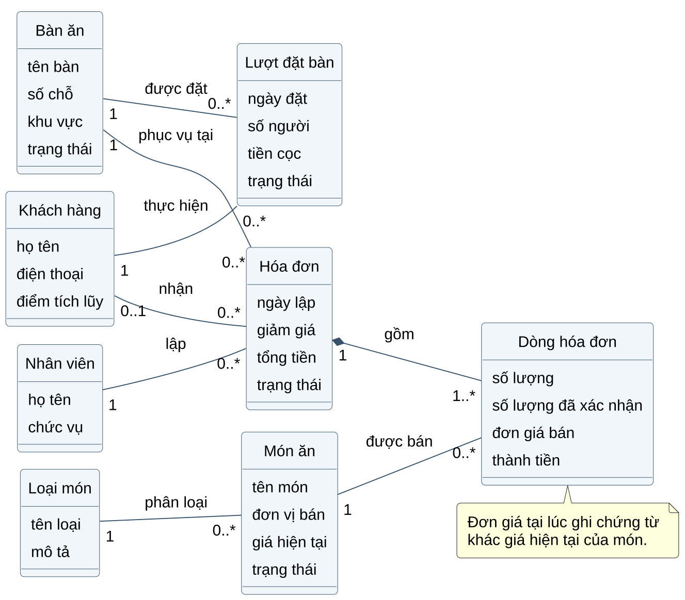

Trên Hình 2.1, một Khách hàng có thể thực hiện nhiều Lượt đặt bàn (0..*), trong khi mỗi Lượt đặt bàn chỉ gắn với một Khách hàng và một Bàn ăn. Tương tự, một Bàn ăn có thể gắn với nhiều Hóa đơn theo lịch sử phục vụ (1 – 0..*), còn tại một thời điểm hoạt động quy tắc BR03 chỉ cho phép tối đa một hóa đơn chưa thanh toán mở trên bàn đó. Quan hệ giữa Khách hàng và Hóa đơn có bội số 0..1 ở phía Khách hàng để hỗ trợ khách vãng lai.

Hóa đơn hợp thành (composition) từ một đến nhiều Dòng hóa đơn (1 *-- 1..*), thể hiện rằng dòng chi tiết không có vòng đời nghiệp vụ tách rời khỏi hóa đơn. Thuộc tính đơn giá bán trên Dòng hóa đơn lưu giá tại thời điểm lập chứng từ, độc lập với thuộc tính giá hiện tại trên Món ăn; thuộc tính số lượng đã xác nhận ghi nhận phần món đã chốt để bảo vệ khỏi việc thu ngân giảm nhầm.

## 2.3. Mô hình khái niệm nhập kho

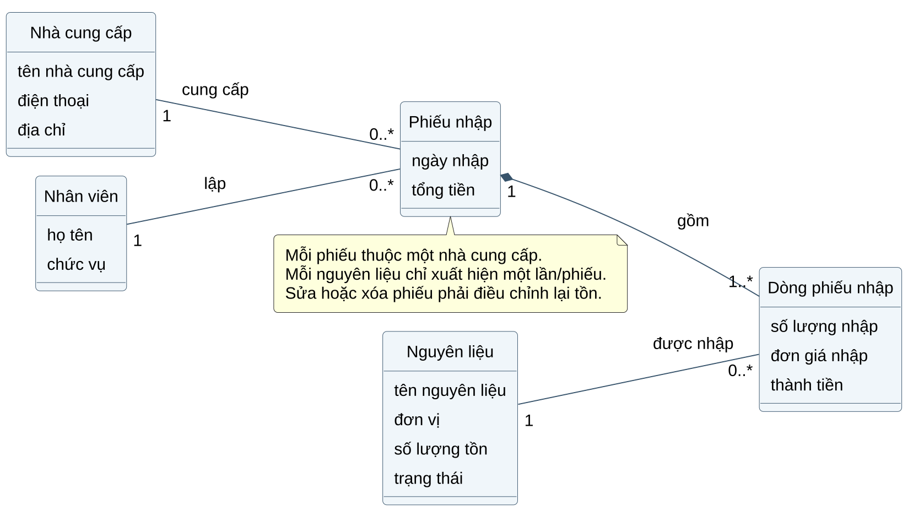

Phiếu nhập ghi nhận một lần nhập hàng từ đúng một Nhà cung cấp, do một Nhân viên lập và chứa ít nhất một Dòng phiếu nhập. Cần phân biệt rõ thuộc tính “đơn giá” giữa hai phân hệ: giá trên Món ăn là giá bán cho thực khách, còn đơn giá trên Dòng phiếu nhập là giá mua nguyên liệu theo từng lần nhập. Hai giá trị này không liên hệ tự động với nhau do chưa có bảng định lượng món – nguyên liệu.

### 2.3.1. Các bất biến nghiệp vụ cần bảo đảm

*Bảng 2.2. Bất biến nghiệp vụ của phân hệ nhập kho*

| Đối tượng | Bất biến cần giữ vững |
| --- | --- |
| Dòng phiếu nhập | Số lượng nhập > 0; đơn giá nhập ≥ 0; thành tiền = số lượng × đơn giá (làm tròn 2 chữ số thập phân). |
| Phiếu nhập | Không chứa hai dòng trùng cùng một nguyên liệu; tổng tiền bằng tổng thành tiền các dòng thuộc phiếu. |
| Nguyên liệu | Số lượng tồn ≥ 0 tại mọi thời điểm sau giao dịch; khi sửa hoặc xóa phiếu nhập phải phản ánh đúng phần chênh lệch tồn. |
| Quan hệ phiếu – dòng | Dòng phiếu nhập không tồn tại độc lập; xóa phiếu nhập kéo theo xóa các dòng chi tiết và hoàn trả lượng tồn tương ứng. |

## 2.4. Bảng CRC và phân bổ trách nhiệm

Bảng CRC (Class – Responsibility – Collaborator) phân bổ trách nhiệm nắm giữ thông tin và cộng tác giữa các lớp khái niệm trước khi ánh xạ sang tầng xử lý phần mềm.

*Bảng 2.3. Bảng CRC các lớp khái niệm nghiệp vụ*

| Lớp khái niệm | Trách nhiệm chính | Lớp cộng tác |
| --- | --- | --- |
| Khách hàng | Lưu thông tin liên hệ và điểm tích lũy. | Lượt đặt bàn, Hóa đơn. |
| Bàn ăn | Lưu tên bàn, sức chứa, khu vực và tình trạng phục vụ. | Lượt đặt bàn, Hóa đơn. |
| Lượt đặt bàn | Ghi nhận nhu cầu đặt trước, số khách, tiền cọc và trạng thái lượt đặt. | Khách hàng, Bàn ăn. |
| Loại món | Phân loại nhóm món ăn và trạng thái kinh doanh của nhóm. | Món ăn. |
| Món ăn | Lưu tên, đơn vị tính, giá bán hiện tại và trạng thái phục vụ. | Loại món, Dòng hóa đơn. |
| Hóa đơn | Ghi nhận chứng từ bán hàng, giảm giá, tổng tiền và trạng thái thanh toán. | Dòng hóa đơn, Bàn ăn, Nhân viên, Khách hàng. |
| Dòng hóa đơn | Lưu số lượng, lượng đã xác nhận, đơn giá bán lịch sử và thành tiền. | Hóa đơn, Món ăn. |
| Nhân viên | Cung cấp thông tin hồ sơ nhân sự và người lập chứng từ. | Hóa đơn, Phiếu nhập. |
| Nhà cung cấp | Lưu thông tin liên hệ đơn vị cung ứng nguyên liệu. | Phiếu nhập. |
| Phiếu nhập | Ghi nhận lần nhập hàng, ngày nhập và tổng giá trị nhập. | Nhà cung cấp, Nhân viên, Dòng phiếu nhập. |
| Dòng phiếu nhập | Lưu nguyên liệu, lượng nhập, giá nhập và thành tiền dòng. | Phiếu nhập, Nguyên liệu. |
| Nguyên liệu | Lưu đơn vị tính, số lượng tồn hiện có và trạng thái sử dụng. | Dòng phiếu nhập. |

### 2.4.1. Chuyển giao trách nhiệm từ phân tích sang thiết kế

Khi chuyển sang kiến trúc Spring Boot, dữ liệu bền vững do các Entity nắm giữ, còn quy tắc phối hợp đa đối tượng và kiểm soát giao dịch được đặt tại tầng Service (HoaDonService, PhieuNhapService, DatBanService). Tầng Controller chỉ tiếp nhận yêu cầu HTTP và điều hướng giao diện, còn Repository chịu trách nhiệm đọc/ghi cơ sở dữ liệu.

## 2.5. Biểu đồ tuần tự hệ thống (SSD) cho UC04 – Lập hóa đơn

Biểu đồ tuần tự hệ thống (SSD) mô tả ranh giới tương tác giữa tác nhân Thu ngân và toàn bộ Hệ thống như một hộp đen, trước khi phân rã vào các lớp phần mềm ở Chương 3.

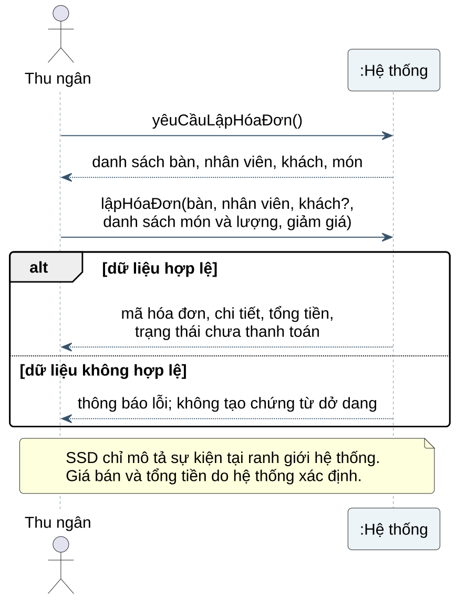

Tác nhân gửi yêu cầu kèm mã bàn, người lập, khách (tùy chọn), danh sách món – số lượng và giảm giá. Hệ thống tự xác định đơn giá bán, gộp dòng trùng, giữ bàn đang dùng và trả về kết quả chứng từ hợp lệ hoặc thông báo từ chối nếu dữ liệu vi phạm bất biến. Trong cài đặt thực tế, sự kiện lậpHóaĐơn(...) tương ứng với phương thức HoaDonService.taoHoaDon(HoaDon, List<Long>, List<BigDecimal>).

## 2.6. Điểm mơ hồ và hợp đồng nghiệp vụ

*Bảng 2.4. Xử lý các điểm mơ hồ từ đề bài nghiệp vụ*

| Điểm cần làm rõ | Quyết định thiết kế và ảnh hưởng |
| --- | --- |
| Thay đổi giá món khi đã có hóa đơn cũ | Đổi giá ở MON_AN không tự cập nhật hóa đơn đã lập. Tuy nhiên, khi sửa hóa đơn chưa thanh toán, HoaDonService đang tải lại giá hiện tại cho toàn bộ chi tiết; nhóm ghi nhận điểm này để cân nhắc chính sách giữ giá cũ nếu mở rộng. |
| Tiền đặt cọc có trừ vào hóa đơn không? | Chưa có khóa ngoại liên kết trực tiếp giữa DAT_BAN và HOA_DON nên tiền cọc chỉ ghi nhận trên phiếu đặt bàn, chưa tự bù trừ khi thanh toán hóa đơn. |
| Đặt bàn theo ngày hay theo khung giờ? | DAT_BAN.NGAY_DAT dùng LocalDate và kiểm tra trạng thái bàn toàn cục; chưa hỗ trợ kiểm tra trùng lịch theo khung giờ trong ngày. |
| Doanh thu tính theo ngày lập hay ngày thanh toán? | Bảng HOA_DON hiện dùng NGAY_LAP và lọc trạng thái “Da thanh toan”; chưa có cột thời điểm thanh toán tách riêng. |
| Tồn kho có tự trừ khi bán món không? | Chưa có bảng định lượng món ăn – nguyên liệu nên tồn kho phản ánh lượng khai báo và nhập kho qua PhieuNhapService. |

### 2.6.1. Hợp đồng thao tác lập hóa đơn (taoHoaDon)

Tiền điều kiện: người dùng đã đăng nhập với vai trò hợp lệ; bàn tồn tại, đang “Trống” và chưa có hóa đơn mở; nhân viên lập có giá trị; danh sách món khác rỗng, mỗi số lượng > 0 và giảm giá ≥ 0. Hậu điều kiện: tạo một HoaDon trạng thái “Chua thanh toan”, tạo một CTHoaDon cho mỗi mã món sau khi gộp với soLuongDaXacNhan = 0 và đơn giá lấy từ server, chuyển trạng thái BanAn sang “Đang dùng”, tính tongTien = max(0, tổng chi tiết − giảm giá). Nếu xảy ra ngoại lệ thì rollback toàn bộ thay đổi.

### 2.6.2. Hợp đồng thao tác sửa phiếu nhập (PhieuNhapService.save)

Tiền điều kiện: phiếu nhập tồn tại, phienBan trên biểu mẫu khớp với DB, nhà cung cấp và nhân viên tồn tại, chi tiết không trùng mã nguyên liệu. Hậu điều kiện: cập nhật phiếu và chi tiết mới, điều chỉnh tồn kho từng nguyên liệu theo chênh lệch (mới − cũ) mà vẫn bảo đảm tồn nằm trong [0; 99.999.999,99], tăng PHIEN_BAN để vô hiệu hóa form cũ. Toàn bộ thao tác thực hiện nguyên tử trong một giao dịch.

# CHƯƠNG 3. THIẾT KẾ HỆ THỐNG

## 3.1. Kiến trúc và hướng phụ thuộc

Hệ thống áp dụng kiến trúc phân tầng kết hợp tư duy Boundary – Control – Entity (BCE) trên nền tảng Spring Boot MVC. Hướng phụ thuộc đi một chiều từ ngoài vào trong, giúp tách biệt rõ tầng giao tiếp HTTP, tầng điều phối nghiệp vụ và tầng truy xuất lưu trữ.

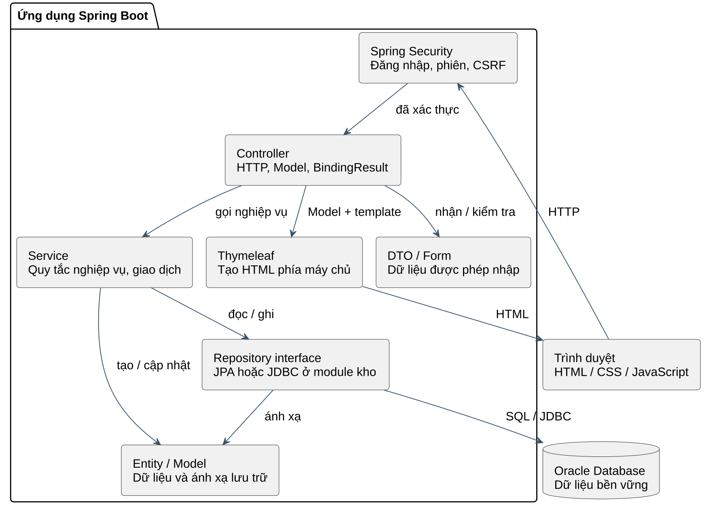

Thành phần Boundary gồm giao diện Thymeleaf và các lớp Controller tiếp nhận HTTP GET/POST, kiểm tra @Valid trên DTO/Form và chuyển tiếp xuống Service. Thành phần Control gồm các lớp Service quản lý quy tắc nghiệp vụ và giao dịch @Transactional. Thành phần Entity ánh xạ dữ liệu bền vững sang Oracle thông qua Spring Data JPA (riêng NhanVienNhapKhoRepository sử dụng JdbcTemplate để chỉ đọc bảng NHAN_VIEN dùng chung cho phân hệ kho). Spring Security nằm ở lớp biên ngoài để chặn truy cập chưa xác thực, kiểm tra 4 vai trò theo URL và bảo vệ CSRF.

## 3.2. Sequence Diagram – Lập hóa đơn (UC04)

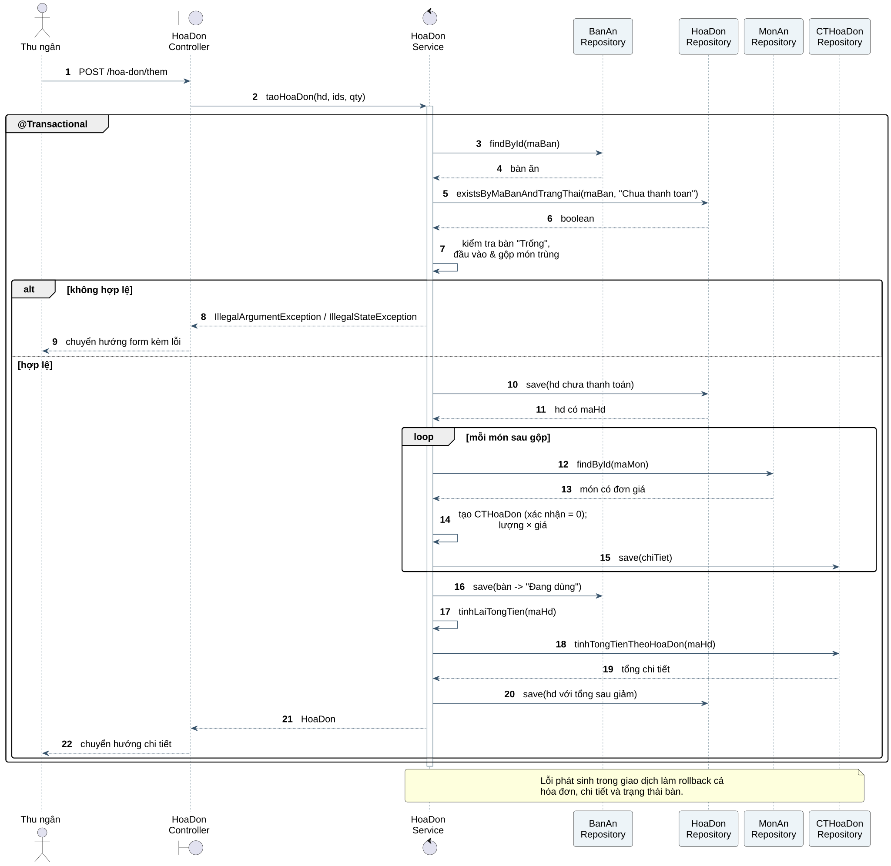

Khi nhận POST /hoa-don/them, HoaDonService mở giao dịch @Transactional, đọc BanAn từ BanAnRepository, kiểm tra bàn phải ở trạng thái “Trống” và chưa có hóa đơn mở qua HoaDonRepository.existsByMaBanAndTrangThai. Tiếp theo, service gộp các mã món trùng, lưu phần đầu HoaDon, lặp tạo từng CTHoaDon (soLuongDaXacNhan = 0) theo giá từ MonAnRepository, chuyển trạng thái bàn sang “Đang dùng” và gọi tinhLaiTongTien(maHd). Bất kỳ lỗi nào phát sinh (chẳng hạn một mã món không tồn tại) đều làm rollback cả hóa đơn, chi tiết và trạng thái bàn.

## 3.3. Sequence Diagram – Ghi nhận thanh toán (UC05)

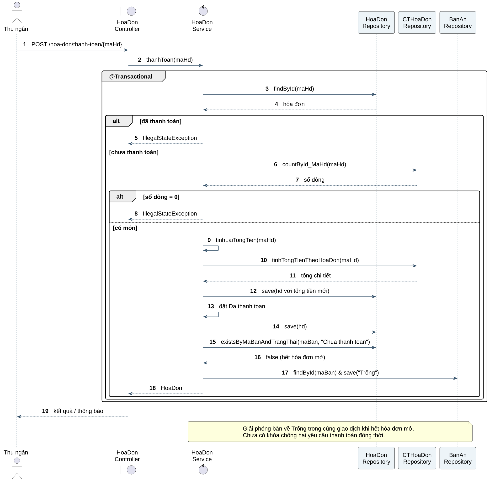

Trong phương thức thanhToan(maHd), HoaDonService kiểm tra hai điều kiện tiên quyết trước khi kết thúc chứng từ: hóa đơn chưa ở trạng thái “Da thanh toan” và số dòng chi tiết đếm bằng countById_MaHd > 0. Sau khi tính lại tổng tiền và lưu trạng thái “Da thanh toan”, service gọi capNhatTrangThaiBanNeuKhongConHoaDonChuaThanhToan(maBan) để kiểm tra và cập nhật bàn về “Trống” thông qua BanAnRepository ngay trong cùng giao dịch. Phương thức hiện kiểm tra tuần tự bằng đọc trạng thái; nếu muốn chống hai yêu cầu thanh toán gửi đồng thời, cần bổ sung khóa bi quan hoặc trường phiên bản.

## 3.4. Sequence Diagram – Điều chỉnh phiếu nhập (UC06)

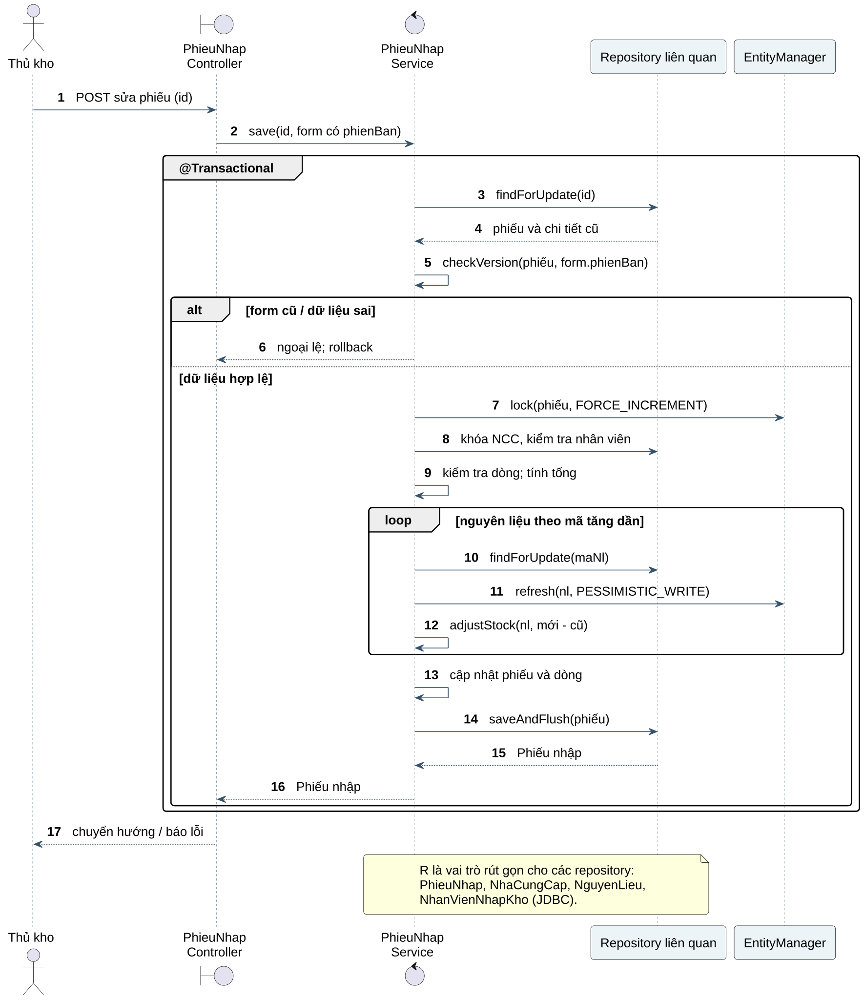

Để tránh sai lệch tồn kho khi nhiều người cùng sửa phiếu hoặc khi form đã lỗi thời, PhieuNhapService dùng findForUpdate(id) để khóa dòng phiếu, đối chiếu PHIEN_BAN với giá trị form gửi lên và gọi EntityManager.lock(..., PESSIMISTIC_FORCE_INCREMENT) nhằm bảo đảm tăng phiên bản ngay cả khi chỉ sửa các dòng con. Các nguyên liệu thuộc cả chi tiết cũ và chi tiết mới được tập hợp và khóa theo thứ tự mã tăng dần (TreeSet) kèm refresh(..., PESSIMISTIC_WRITE) để lấy tồn kho mới nhất trước khi cộng phần chênh lệch (mới − cũ).

## 3.5. Biểu đồ lớp thiết kế (DCD) phân hệ hóa đơn

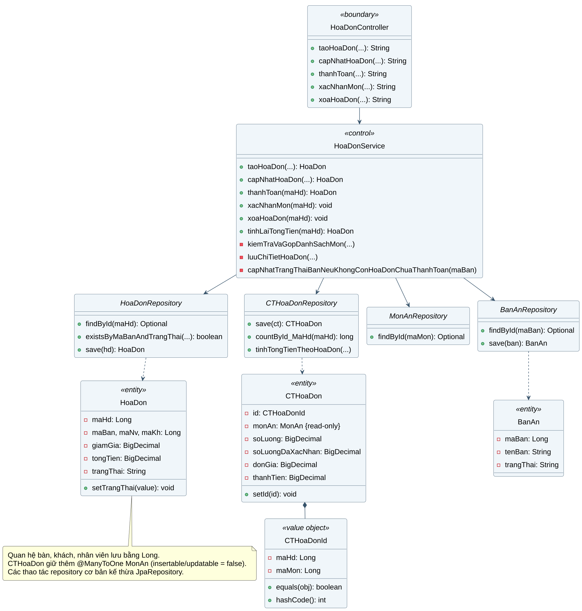

CTHoaDon sử dụng khóa ghép EmbeddedId (CTHoaDonId gồm maHd và maMon, ghi đè equals/hashCode nhất quán) cùng thuộc tính soLuongDaXacNhan và liên kết @ManyToOne MonAn dạng chỉ đọc (insertable = false, updatable = false). HoaDon hiện lưu các mã liên kết (maBan, maNv, maKh) bằng Long và không giữ collection chi tiết bên trong entity. HoaDonService phụ thuộc các interface HoaDonRepository, CTHoaDonRepository, MonAnRepository và BanAnRepository để xử lý toàn bộ vòng đời tạo, sửa, xác nhận món, xóa và thanh toán hóa đơn.

## 3.6. Biểu đồ lớp thiết kế (DCD) phân hệ nhập kho

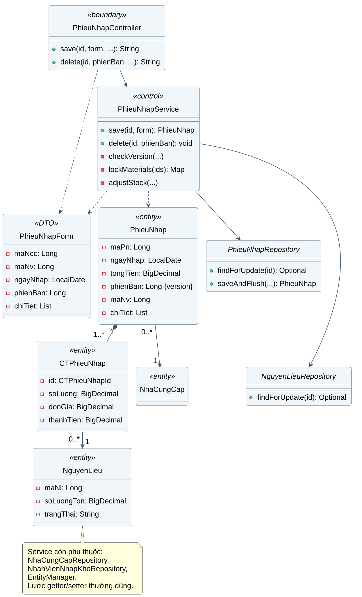

Khác với phân hệ hóa đơn đang bind trực tiếp entity ở Controller, phân hệ nhập kho tách riêng DTO PhieuNhapForm (chứa phienBan và danh sách DongNhapForm) để giới hạn dữ liệu đầu vào bằng WebDataBinder. Entity PhieuNhap giữ tập chi tiết CTPhieuNhap với cascade = ALL và orphanRemoval = true, tham chiếu @ManyToOne tới NhaCungCap, sử dụng @Version trên trường phienBan và lưu mã nhân viên bằng Long để tránh phụ thuộc chéo trực tiếp vào entity NhanVien của module khác.

## 3.7. State Machine của hóa đơn

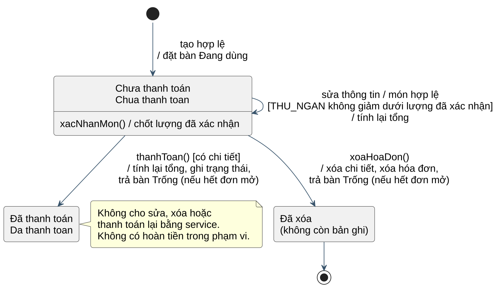

*Bảng 3.1. Bảng chuyển trạng thái và điều kiện bảo vệ của HoaDon*

| Sự kiện / Thao tác | Điều kiện bảo vệ và tác động trạng thái |
| --- | --- |
| taoHoaDon() | Bàn phải đang “Trống”, chưa có hóa đơn mở và danh sách món hợp lệ; tạo hóa đơn trạng thái “Chua thanh toan” và chuyển bàn sang “Đang dùng”. |
| xacNhanMon() | Áp dụng khi hóa đơn “Chua thanh toan”; chốt soLuongDaXacNhan bằng số lượng hiện tại trên từng dòng chi tiết. |
| capNhatHoaDon() | Chỉ thực hiện khi “Chua thanh toan”; nếu vai trò là THU_NGAN thì không được giảm hoặc xóa dưới mức soLuongDaXacNhan; tính lại tổng tiền. |
| thanhToan() | Yêu cầu trạng thái “Chua thanh toan” và countById_MaHd > 0; chuyển sang “Da thanh toan” và trả bàn về “Trống” nếu hết đơn mở. |
| xoaHoaDon() | Chỉ thực hiện khi “Chua thanh toan”; xóa toàn bộ chi tiết trước khi xóa hóa đơn và trả bàn về “Trống” nếu hết đơn mở. |
| Thao tác sau thanh toán | Mọi lệnh sửa, xóa, xác nhận món hoặc thanh toán lại trên hóa đơn “Da thanh toan” đều ném IllegalStateException. |

## 3.8. State Machine đặt bàn và khoảng cách cài đặt

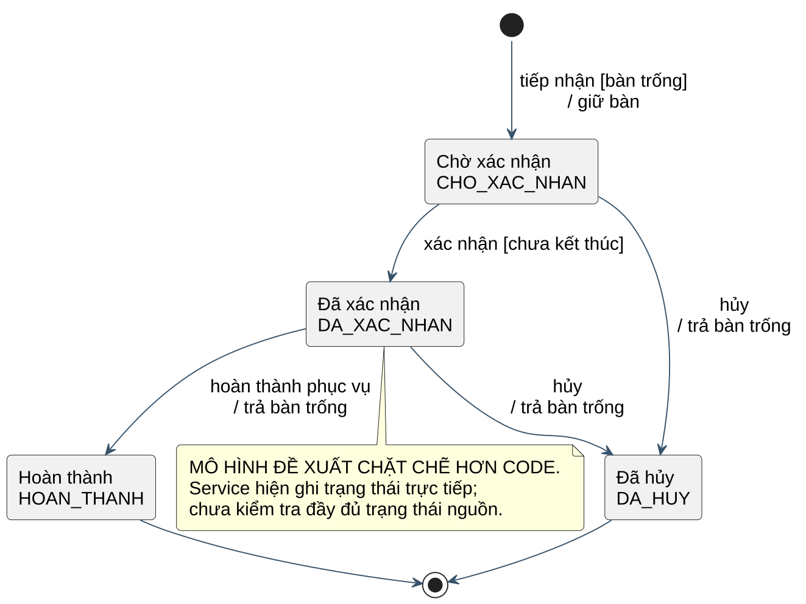

Hình 3.8 mô tả máy trạng thái mục tiêu cho vòng đời đặt bàn nhằm đáp ứng đầy đủ BR01–BR02, trong đó DA_HUY và HOAN_THANH là hai trạng thái kết thúc và một lượt đặt chỉ được phép hoàn thành sau khi đã chuyển qua DA_XAC_NHAN.

*Bảng 3.2. Đối chiếu cài đặt đặt bàn hiện tại với mô hình đề xuất*

| Khía cạnh | Cài đặt hiện tại trong mã nguồn | Khoảng cách cần bổ sung theo đề xuất |
| --- | --- | --- |
| Chuyển trạng thái nguồn | DatBanService.xacNhan, huyDatBan, hoanThanh gán thẳng trạng thái mới nếu tìm thấy mã đặt. | Bổ sung kiểm tra trạng thái nguồn (ví dụ cấm xác nhận hoặc hoàn thành lại lượt đã hủy/đã hoàn thành). |
| Trả trạng thái bàn ăn | Hủy hoặc hoàn thành đặt bàn đặt thẳng trạng thái bàn về “Trống”. | Kiểm tra bàn có đang phát sinh hóa đơn chưa thanh toán hoặc lượt đặt khác đang hiệu lực trước khi trả “Trống”. |
| Giao dịch tiếp nhận | DatBanController kiểm tra bàn “Trống”, lưu DatBan rồi gọi BanAnService đổi sang “Đã đặt”. | Gộp hai thao tác lưu vào một phương thức @Transactional tại DatBanService, thêm kiểm tra sức chứa và khóa bàn chống đặt trùng. |

## 3.9. Giải thích quyết định thiết kế bằng GRASP và SOLID

*Bảng 3.3. Lập luận quyết định thiết kế dựa trên GRASP và SOLID*

| Nguyên tắc | Áp dụng cụ thể và hệ quả thiết kế |
| --- | --- |
| Controller (GRASP) | Tách HoaDonController và PhieuNhapController làm điểm tiếp nhận HTTP; toàn bộ công thức tính tiền, xác nhận món và tồn kho đặt ở tầng Service để tránh rải logic nghiệp vụ ra giao diện Thymeleaf hoặc JavaScript. |
| Information Expert (GRASP) | MonAn giữ đơn giá bán hiện tại, CTHoaDon giữ đơn giá lịch sử và lượng đã xác nhận, NguyenLieu giữ tồn hiện có. Do kiến trúc theo hướng Service, các Service truy vấn qua Repository và thực hiện tính toán tập trung. |
| Creator (GRASP) | HoaDonService chịu trách nhiệm khởi tạo HoaDon và các dòng CTHoaDon khi đầu vào hợp lệ; thực thể PhieuNhap quản lý vòng đời tập con CTPhieuNhap bằng cascade và orphanRemoval. |
| High Cohesion & SRP | Mỗi phân hệ có Service và Repository riêng (LoaiMonService, MonAnService, HoaDonService, PhieuNhapService, BaoCaoService, TaiKhoanService) giúp thay đổi chính sách hóa đơn không ảnh hưởng tới quản lý nhân sự hay kho. |
| Low Coupling & DIP | Service phụ thuộc vào các interface Repository của Spring Data JPA và NhanVienNhapKhoRepository (chỉ đọc JDBC) thay vì mở kết nối SQL thủ công hay phụ thuộc chặt giữa các module ngang cấp. |
| Bảo vệ ranh giới đầu vào | Các module danh mục, nhân sự và kho sử dụng DTO/Form kèm @Valid và setAllowedFields(). Module hóa đơn hiện nhận @ModelAttribute HoaDon nên được đề xuất nâng cấp sang DTO riêng trong phiên bản tới. |

### 3.9.1. Các phương án thiết kế đã cân nhắc

Thứ nhất, với tồn kho khi nhập hàng, mã SQL trong database/oracle/02_routines.sql có chứa procedure quản trị riêng và trigger TRG_CTPN_THANH_TIEN chỉ tính thành tiền dòng chứ không tự cộng tồn; việc cộng/trừ tồn của luồng web được tập trung hoàn toàn tại PhieuNhapService để tránh lỗi cộng tồn hai lần và bảo đảm đồng bộ khóa/phiên bản. Thứ hai, nhóm không tự ý tạo các mẫu Strategy hay cây kế thừa phức tạp cho chính sách giảm giá hoặc phân loại nhân viên vì bài toán hiện tại chỉ có một kiểu giảm giá trực tiếp; thiết kế giữ sự tinh gọn nhưng vẫn dễ mở rộng khi phát sinh biến thể mới.

## 3.10. Thiết kế dữ liệu (ERD) phân hệ bán hàng, khách hàng và đặt bàn

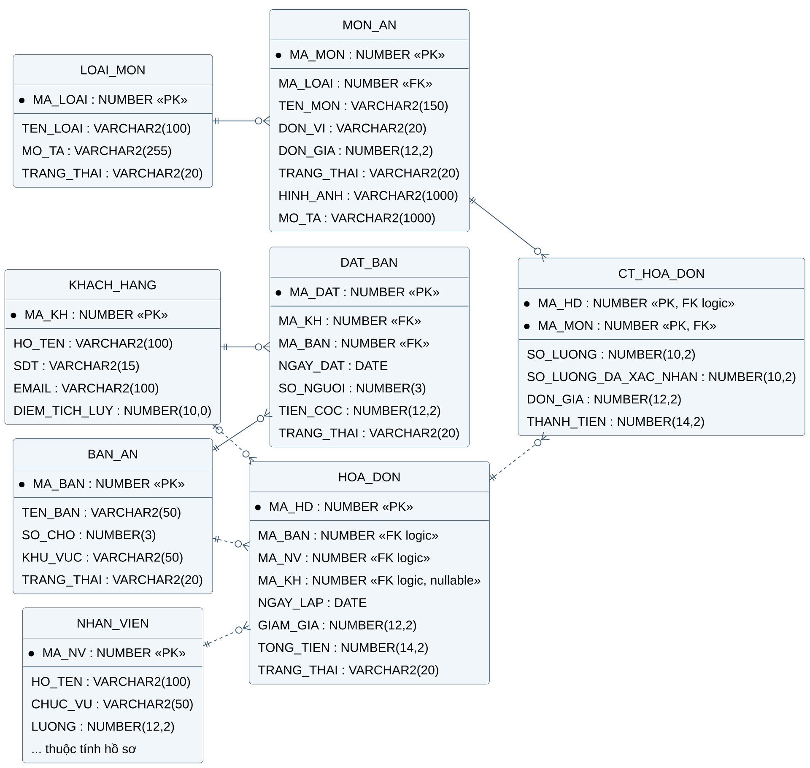

Hình 3.9 biểu diễn 8 bảng nghiệp vụ thuộc phân hệ khách hàng, đặt bàn, thực đơn và bán hàng. Đường nối nét liền biểu thị các quan hệ có ánh xạ đối tượng JPA (@ManyToOne trên DAT_BAN, MON_AN và ánh xạ chỉ đọc @ManyToOne MonAn trên CT_HOA_DON); đường nét đứt kèm nhãn FK logic biểu thị quan hệ tham chiếu lưu bằng mã Long trên entity (như MA_BAN, MA_NV, MA_KH của HOA_DON và MA_HD của CT_HOA_DON). Khi triển khai trên Oracle thật, cần đối chiếu DDL thực tế để bảo đảm đủ khóa ngoại vật lý cho các cột FK logic.

## 3.11. Thiết kế dữ liệu (ERD) phân hệ kho và bảng tài khoản

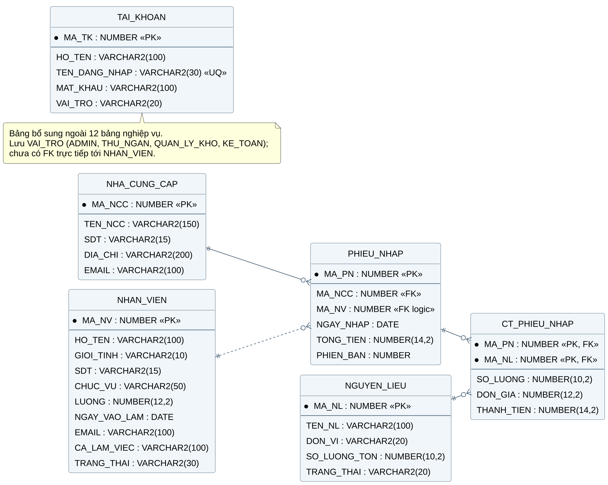

Hình 3.10 bổ sung 4 bảng phân hệ kho (NHA_CUNG_CAP, PHIEU_NHAP, CT_PHIEU_NHAP, NGUYEN_LIEU) cùng bảng TAI_KHOAN để hoàn thiện toàn bộ 13 bảng trong cơ sở dữ liệu. Bảng NHAN_VIEN được hiển thị lại để thể hiện liên kết lập phiếu nhập (PHIEU_NHAP.MA_NV có ràng buộc FK trong script 01_inventory.sql nhưng lưu bằng Long trên entity Java). Bảng TAI_KHOAN có ràng buộc duy nhất UK_TAI_KHOAN_TEN_DANG_NHAP trên TEN_DANG_NHAP và cột VAI_TRO VARCHAR2(20) lưu một trong 4 vai trò phân quyền của hệ thống.

## 3.12. Khóa, ánh xạ và ràng buộc dữ liệu

*Bảng 3.4. Tổng hợp khóa chính, quan hệ và chiến lược ánh xạ 13 bảng dữ liệu*

| Tên bảng | Khóa chính & khóa tham chiếu | Chiến lược ánh xạ JPA và ràng buộc chính |
| --- | --- | --- |
| KHACH_HANG | PK: MA_KH | Identity; DIEM_TICH_LUY mặc định 0. |
| BAN_AN | PK: MA_BAN | Identity; TEN_BAN, SO_CHO, KHU_VUC, TRANG_THAI. |
| DAT_BAN | PK: MA_DAT; FK: MA_KH, MA_BAN | Identity; @ManyToOne tới KhachHang và BanAn (@NotFound IGNORE). |
| LOAI_MON | PK: MA_LOAI | Sequence SEQ_LOAI_MON; bảo vệ xóa khi còn món. |
| MON_AN | PK: MA_MON; FK: MA_LOAI | Sequence SEQ_MON_AN; @ManyToOne LoaiMon (NOT NULL); DON_GIA NUMBER(12,2). |
| NHAN_VIEN | PK: MA_NV | Sequence SEQ_NHAN_VIEN; bảo vệ xóa khi có hóa đơn hoặc phiếu nhập. |
| HOA_DON | PK: MA_HD; MA_BAN, MA_NV, MA_KH | Identity; các mã cha lưu bằng Long; MA_KH cho phép NULL. |
| CT_HOA_DON | PK ghép: (MA_HD, MA_MON) | @EmbeddedId CTHoaDonId; @ManyToOne MonAn (chỉ đọc); có SO_LUONG_DA_XAC_NHAN NUMBER(10,2). |
| NHA_CUNG_CAP | PK: MA_NCC | Sequence SEQ_NHA_CUNG_CAP; bảo vệ xóa khi có phiếu nhập. |
| NGUYEN_LIEU | PK: MA_NL | Sequence SEQ_NGUYEN_LIEU; SO_LUONG_TON NUMBER(10,2); CHECK >= 0 ở script SQL. |
| PHIEU_NHAP | PK: MA_PN; FK: MA_NCC; MA_NV | Sequence SEQ_PHIEU_NHAP; @ManyToOne NhaCungCap; @Version PHIEN_BAN; @OneToMany chiTiet. |
| CT_PHIEU_NHAP | PK ghép: (MA_PN, MA_NL) | @EmbeddedId + @MapsId với PhieuNhap và NguyenLieu. |
| TAI_KHOAN | PK: MA_TK; UQ: TEN_DANG_NHAP | Sequence SEQ_TAI_KHOAN; MAT_KHAU lưu BCrypt; VAI_TRO VARCHAR2(20). |

Việc dùng khóa ghép trên CT_HOA_DON và CT_PHIEU_NHAP giúp ngăn chặn ở tầng dữ liệu tình trạng một món hoặc một nguyên liệu xuất hiện hai dòng trùng lặp trong cùng một chứng từ. Đối với Oracle thực tế, script 01_inventory.sql đã định nghĩa đầy đủ các ràng buộc CHECK và khóa ngoại cho nhóm bảng kho; không nên phụ thuộc hoàn toàn vào hibernate.ddl-auto=update để sinh ràng buộc toàn vẹn mà cần chạy script DDL chuẩn khi triển khai.

## 3.13. Thiết kế giao dịch và ví dụ tính toán

### 3.13.1. Tính tiền hóa đơn

Công thức tính ở HoaDonService bảo đảm thành tiền từng dòng = số lượng × đơn giá và tổng hóa đơn = max(0, tổng thành tiền các dòng − giảm giá), toàn bộ dùng kiểu BigDecimal để tránh sai số dấu phẩy động.

*Bảng 3.5. Các tình huống minh họa tính toán hóa đơn*

| Tình huống đầu vào | Kết quả xử lý của HoaDonService |
| --- | --- |
| 1,5 kg Tôm (320.000 đ/kg) + 2 đĩa Nghêu (120.000 đ/đĩa); giảm 20.000 đ | Tổng chi tiết 720.000 đ; tổng phải thu 700.000 đ; bàn sang Đang dùng. |
| Nhập trùng món Tôm với 2 dòng: 0,5 kg và 1,0 kg | Gộp qua Map thành 1 dòng (MA_HD, MA_MON) có số lượng 1,50 kg. |
| Tổng chi tiết 720.000 đ; nhập giảm giá 800.000 đ | Code hiện chặn âm nên đưa TONG_TIEN về 0 đ (cần thống nhất thêm quy tắc nếu muốn từ chối mức giảm vượt tổng). |
| Đổi giá món trong thực đơn sau khi hóa đơn đã thanh toán | CT_HOA_DON giữ nguyên đơn giá lịch sử tại thời điểm lập/cập nhật trước thanh toán. |

### 3.13.2. Điều chỉnh tồn kho theo chênh lệch

*Bảng 3.6. Minh họa cơ chế điều chỉnh tồn theo chênh lệch ở PhieuNhapService*

| Thao tác trên chứng từ | Tồn trước | Biến động (delta) | Tồn sau |
| --- | --- | --- | --- |
| Khởi tạo nguyên liệu ban đầu | 10,00 kg | — | 10,00 kg |
| Lập phiếu nhập mới 5,00 kg | 10,00 kg | +5,00 kg | 15,00 kg |
| Sửa phiếu từ 5,00 kg xuống 3,00 kg | 15,00 kg | 3,00 − 5,00 = −2,00 kg | 13,00 kg |
| Xóa phiếu đang ghi 3,00 kg | 13,00 kg | −3,00 kg | 10,00 kg |

## 3.14. Ma trận truy vết và kiểm tra nhất quán

Ma trận truy vết bảo đảm mọi yêu cầu chức năng và quy tắc nghiệp vụ ở Chương 1 đều liên kết xuyên suốt đến mô hình phân tích (Chương 2), thiết kế cài đặt (Chương 3) và các ca kiểm thử (Chương 4).

*Bảng 3.7. Ma trận truy vết từ yêu cầu đến thiết kế và kiểm thử*

| Yêu cầu / BR | Mô hình phân tích | Thiết kế / Thành phần cài đặt | Kiểm chứng (H2 & JS) |
| --- | --- | --- | --- |
| UC01, UC11; NFR01 | Nhân viên nội bộ, phân tích quyền. | SecurityConfig, TaiKhoanService, TaiKhoanController, AuthController. | TC19–TC20; đạt trong MenuCrudIntegrationTests. |
| UC02, UC08; BR11 | Loại món, Món ăn, Nhân viên. | LoaiMonService, MonAnService, NhanVienService, DTO Form. | Đạt đầy đủ CRUD, validation, bảo vệ xóa (MenuCrudIntegrationTests). |
| UC03; BR01–02 | Khách hàng, Bàn ăn, Lượt đặt bàn. | State Machine Hình 3.8; DatBanController, DatBanService. | TC01–TC02 đạt; TC03 ghi nhận thiếu khóa đồng thời. |
| UC04; BR03–05 | Hóa đơn, Dòng hóa đơn; SSD Hình 2.3. | SD Hình 3.2; DCD Hình 3.5; HoaDonService (taoHoaDon, capNhatHoaDon, xacNhanMon). | TC04–TC07 đạt trong BusinessRulesIntegrationTests. |
| UC05; BR06 | Vòng đời Hóa đơn & Bàn ăn. | SD Hình 3.3; State Hình 3.7; HoaDonService.thanhToan, xoaHoaDon. | TC08–TC09 đạt; TC10 ghi nhận thiếu khóa đồng thời. |
| UC06, UC09; BR07–10 | Phiếu nhập, Dòng nhập, Nguyên liệu. | SD Hình 3.4; DCD Hình 3.6; PhieuNhapService, PhieuNhapForm. | TC11–TC16 đạt trong BusinessRulesIntegrationTests. |
| UC07; BR12 | Tổng hợp từ Hóa đơn đã thanh toán. | BaoCaoService, BaoCaoController, CTHoaDonRepository. | TC17–TC18 đạt trong BusinessRulesIntegrationTests. |

### 3.14.1. Tổng hợp đối chiếu nhất quán giữa mô hình và mã nguồn

Tất cả 14 sơ đồ UML và tên lớp/phương thức trong tài liệu đã được rà soát đồng bộ với mã nguồn: vai trò phân quyền phản ánh đúng 4 vai trò (ADMIN, THU_NGAN, QUAN_LY_KHO, KE_TOAN); luồng lập và thanh toán hóa đơn thể hiện đầy đủ việc giữ bàn “Đang dùng” và trả bàn “Trống”; thực thể CTHoaDon và bảng CT_HOA_DON thể hiện cột SO_LUONG_DA_XAC_NHAN cùng thao tác xacNhanMon. Riêng State Machine đặt bàn được gắn nhãn đề xuất cho phần guard trạng thái nguồn và khóa đồng thời chưa có trong DatBanService.

# CHƯƠNG 4. CÀI ĐẶT VÀ KIỂM THỬ

## 4.1. Công nghệ và cấu trúc dự án

*Bảng 4.1. Công nghệ và công cụ sử dụng trong dự án QuanLyNHHS*

| Thành phần | Thông số xác minh trong mã nguồn (pom.xml & cấu hình) |
| --- | --- |
| Ngôn ngữ & Framework | Java JDK 27 (java.version=27); Spring Boot 4.1.1 (spring-boot-starter-parent). |
| Giao diện Web | Spring Web MVC, Thymeleaf; giao diện tĩnh HTML/CSS/JavaScript (main.js) trong src/main/resources. |
| Tầng nghiệp vụ & Dữ liệu | Spring Transaction (@Transactional); Spring Data JPA / Hibernate ORM 7.4.5; JdbcTemplate ở NhanVienNhapKhoRepository. |
| Cơ sở dữ liệu | Oracle JDBC ojdbc17 kết nối mặc định localhost:1521/FREEPDB1 (hỗ trợ biến môi trường DB_URL, DB_USERNAME, DB_PASSWORD). |
| Bảo mật & Validation | Spring Security; BCryptPasswordEncoder (strength = 12); Jakarta Bean Validation và DataBinder. |
| Kiểm thử tự động | JUnit 5 + Spring Boot Test + MockMvc + H2 (MODE=Oracle, profile test); Node.js built-in test runner cho JavaScript. |

Cấu trúc thư mục mã nguồn của dự án QuanLyNHHS được tổ chức chuẩn theo phân tầng Maven và Spring Boot:

```java
QuanLyNHHS/
  src/main/java/com/QuanLyNHHS/
    config/       (SecurityConfig)
    controller/   (Auth, BanAn, BaoCao, DatBan, HoaDon, Home, KhachHang, Kho, LoaiMon, MonAn, ...)
    dto/          (DongNhapForm, PhieuNhapForm, LoaiMonForm, MonAnForm, NhanVienForm, ...)
    model/        (13 Entity: BanAn, CTHoaDon, CTPhieuNhap, DatBan, HoaDon, KhachHang, ..., TaiKhoan)
    repository/   (13 JpaRepository + NhanVienNhapKhoRepository)
    service/      (BanAn, BaoCao, DatBan, HoaDon, KhachHang, LoaiMon, MonAn, NguyenLieu, ...)
  src/main/resources/
    templates/ & static/ & application.properties & oracle_setup_user.sql
  src/test/java/  (MenuCrudIntegrationTests, BusinessRulesIntegrationTests, DatabasePagesTests, ...)
  src/test/js/    (menu-filters.test.cjs)
  database/oracle/ (01_inventory.sql, 02_routines.sql, 03_insert_data.sql, 04_du_lieu_kiem_thu.sql, 05_phan_quyen.sql)
```

## 4.2. Minh chứng cài đặt UC04 và UC05

Trong phân hệ hóa đơn, HoaDonService chịu trách nhiệm thực thi các quy tắc nghiệp vụ cốt lõi: bảo vệ số lượng món đã xác nhận trước quyền THU_NGAN khi cập nhật hóa đơn và thực hiện thanh toán đồng thời giải phóng bàn ăn trong một giao dịch nguyên tử.

```java
// Trích kiểm tra món đã xác nhận trong HoaDonService.capNhatHoaDon(...)
for (CTHoaDon chiTiet : ctHoaDonRepository.findById_MaHd(hoaDon.getMaHd())) {
    BigDecimal confirmed = chiTiet.getSoLuongDaXacNhan();
    if (confirmed.signum() > 0) {
        daXacNhan.put(chiTiet.getMaMon(), confirmed);
        if (laThuNgan() && danhSachMon.getOrDefault(chiTiet.getMaMon(), BigDecimal.ZERO).compareTo(confirmed) < 0) {
            throw new IllegalStateException("Khong the giam hoac xoa mon da xac nhan");
        }
    }
}
```

Đoạn trích phương thức thanhToan(Long maHd) trong service/HoaDonService.java minh họa đúng luồng kiểm tra trạng thái, đếm chi tiết, tính lại tổng tiền, chốt trạng thái thanh toán và giải phóng bàn ăn trong cùng @Transactional:

```java
@Transactional
public HoaDon thanhToan(Long maHd) {
    HoaDon hoaDon = timTheoMa(maHd);
    if (DA_THANH_TOAN.equals(hoaDon.getTrangThai())) {
        throw new IllegalStateException("Hoa don da duoc thanh toan");
    }
    if (ctHoaDonRepository.countById_MaHd(maHd) == 0) {
        throw new IllegalStateException("Hoa don chua co mon an");
    }
    Long maBan = hoaDon.getMaBan();
    tinhLaiTongTien(maHd);
    hoaDon.setTrangThai(DA_THANH_TOAN);
    HoaDon hoaDonDaThanhToan = hoaDonRepository.save(hoaDon);
    capNhatTrangThaiBanNeuKhongConHoaDonChuaThanhToan(maBan);
    return hoaDonDaThanhToan;
}
```

## 4.3. Minh chứng UC06 và phân quyền ứng dụng

### 4.3.1. Giao dịch phiếu nhập và điều chỉnh tồn kho

Khi thêm mới hoặc cập nhật phiếu nhập tại PhieuNhapService.save(id, form), service khóa phiếu (nếu sửa), kiểm tra phiên bản, khóa toàn bộ danh sách nguyên liệu thuộc chi tiết cũ và mới theo thứ tự mã tăng dần rồi mới áp dụng mức chênh lệch tồn kho:

```java
BigDecimal before = previousDetail == null ? BigDecimal.ZERO : previousDetail.getSoLuong();
BigDecimal after = line == null ? BigDecimal.ZERO : line.getSoLuong();
adjustStock(ingredient, after.subtract(before));
```

Cách tiếp cận này xử lý thống nhất cả ba trường hợp: dòng mới thêm (before = 0), dòng thay đổi lượng (after − before) và dòng bị loại khỏi phiếu (after = 0), đồng thời giữ nguyên thực thể khóa ghép của các dòng vẫn còn tồn tại.

### 4.3.2. Phân quyền ứng dụng 4 vai trò và lớp quyền Oracle

*Bảng 4.2. Cấu hình phân quyền 4 vai trò trong SecurityConfig và tầng Oracle*

| Vai trò / Tầng | Phạm vi quyền được thực thi |
| --- | --- |
| ADMIN | Toàn quyền trên hệ thống: quản lý tài khoản (/tai-khoan/**), nhân viên (/nhan-vien/**), thực đơn (/mon-an/**, /loai-mon/**), cấu hình bàn ăn, xóa hóa đơn/đặt bàn và toàn bộ nghiệp vụ khác. |
| THU_NGAN | Truy cập trang chủ, quản lý khách hàng (/khach-hang/**), đặt bàn trừ xóa (/dat-ban/**), xem danh sách bàn (GET /ban-an), lập/sửa/xác nhận món và thanh toán hóa đơn trừ xóa (/hoa-don/**); bị chặn giảm/xóa món đã xác nhận. |
| QUAN_LY_KHO | Quản lý kho tổng quan (/kho), danh mục nguyên liệu (/nguyen-lieu/**), nhà cung cấp (/nha-cung-cap/**) và lập/sửa/xóa phiếu nhập (/phieu-nhap/**). |
| KE_TOAN | Chỉ đọc báo cáo doanh thu (/bao-cao/**), xem hóa đơn (GET /hoa-don, /hoa-don/chi-tiet/**) và xem phiếu nhập (GET /phieu-nhap, /phieu-nhap/*); bị từ chối khi sửa hoặc xóa chứng từ. |
| Tương thích ngược & Oracle | TaiKhoanService.NguoiDung tự động ánh xạ tài khoản cũ QUAN_LY -> ADMIN và NHAN_VIEN -> THU_NGAN khi đăng nhập; riêng script role/privilege trong oracle_setup_user.sql và 05_phan_quyen.sql quản lý quyền ở tầng database, độc lập với phân quyền URL website. |

## 4.4. Giao diện và điểm kiểm tra khi chạy demo

*Bảng 4.3. Bản đồ giao diện Thymeleaf và điểm cần kiểm tra khi demo*

| Ca sử dụng / Trang | Đường dẫn URL | Điểm kiểm tra nghiệp vụ khi chạy demo |
| --- | --- | --- |
| UC01 – Đăng nhập | /login | Đăng nhập tenDangNhap/matKhau với 4 vai trò; nhập sai báo /login?error; không có trang đăng ký tự do. |
| UC02 – Thực đơn | /loai-mon; /mon-an | Chỉ ADMIN truy cập; thêm/sửa kiểm tra giá và URL; tìm kiếm/lọc và chuyển dạng thẻ/bảng bằng JavaScript. |
| UC03 – Đặt bàn | /dat-ban | Chỉ hiển thị bàn Trống khi thêm; chuyển CHO_XAC_NHAN -> DA_XAC_NHAN -> HOAN_THANH/DA_HUY đồng bộ trạng thái bàn. |
| UC04/05 – Hóa đơn | /hoa-don; /hoa-don/chi-tiet/{maHd} | Lập hóa đơn gộp món trùng và giữ bàn Đang dùng; xác nhận món; THU_NGAN không giảm món đã xác nhận; thanh toán trả bàn Trống. |
| UC06 – Phiếu nhập | /phieu-nhap | Biểu mẫu đa dòng; sửa đổi số lượng làm tồn tăng/giảm đúng chênh lệch; thử mở 2 tab sửa cùng lúc để kích hoạt lỗi phienBan cũ. |
| UC07 – Báo cáo | /bao-cao | ADMIN và KE_TOAN truy cập; chọn khoảng ngày hợp lệ và khoảng ngày ngược để kiểm tra doanh thu chỉ tính hóa đơn đã thanh toán. |
| UC08 – Nhân viên | /nhan-vien | Chỉ ADMIN truy cập; bảo vệ xóa nhân viên đã lập hóa đơn hoặc phiếu nhập. |
| UC09 – Kho | /nha-cung-cap; /nguyen-lieu | QUAN_LY_KHO và ADMIN truy cập; đối chiếu tồn kho và bảo vệ tham chiếu khi xóa. |
| UC10 – Khách & Bàn | /khach-hang; /ban-an | Tra cứu khách hàng, xem trạng thái bàn trực quan sau khi đặt bàn và thanh toán. |
| UC11 – Tài khoản | /tai-khoan | Chỉ ADMIN truy cập; tạo tài khoản mới với 4 vai trò chuẩn, kiểm tra mật khẩu lưu dưới dạng chuỗi băm BCrypt. |

## 4.5. Phạm vi và kết quả kiểm chứng thực tế

### 4.5.1. Kiểm thử tự động JavaScript (Node test)

Bộ kiểm thử giao diện src/test/js/menu-filters.test.cjs được chạy bằng lệnh node --test src/test/js/menu-filters.test.cjs, mô phỏng DOM để xác minh các hàm lọc tìm và chuyển chế độ hiển thị trong main.js.

*Bảng 4.4. Kết quả kiểm thử tự động JavaScript (4/4 đạt)*

| Kịch bản kiểm thử JavaScript | Kết quả thực tế |
| --- | --- |
| Tìm kiếm món ăn kết hợp bộ lọc loại món khi thay đổi từng điều kiện | Đạt |
| Tìm kiếm nhân viên kết hợp lọc theo chức vụ đang chọn | Đạt |
| Tìm kiếm loại món theo tên/mã và khôi phục danh sách khi xóa từ khóa | Đạt |
| Chuyển đổi chế độ hiển thị món ăn dạng thẻ (grid) và dạng bảng kèm trạng thái nút | Đạt |

### 4.5.2. Kiểm thử tích hợp Java Spring Boot trên H2 (MODE=Oracle)

Toàn bộ bộ kiểm thử Maven được biên dịch và thực thi bằng lệnh ./mvnw.cmd test trên JDK 27 (profile test sử dụng MockMvc và cơ sở dữ liệu H2 cấu hình MODE=Oracle). Tổng cộng 36/36 bài kiểm thử tự động đều đạt, không có lỗi hoặc bài bị bỏ qua.

*Bảng 4.5. Tổng hợp kết quả thực thi bộ kiểm thử Java Spring Boot (36/36 đạt)*

| Lớp kiểm thử | Số lượng / Kết quả | Phạm vi kịch bản đã xác minh |
| --- | --- | --- |
| DatabasePagesTests | 4 / 4 Đạt | Kiểm tra khởi tạo ngữ cảnh Web MVC và truy cập trang danh mục trên dữ liệu thử. |
| MenuCrudIntegrationTests | 18 / 18 Đạt | Phân quyền tách biệt 4 vai trò và chặn ROLE_NHAN_VIEN trực tiếp; cấp tài khoản ADMIN với BCrypt; CRUD/validation/escape HTML loại món, món ăn, nhân viên; bảo vệ xóa danh mục có chứng từ; bắt buộc đăng nhập, CSRF và vô hiệu hóa /register. |
| QuanLyNhhsApplicationTests | 1 / 1 Đạt | Kiểm tra nạp hoàn chỉnh ngữ cảnh Spring Boot chính của ứng dụng. |
| BusinessRulesIntegrationTests | 13 / 13 Đạt | Kiểm chứng toàn bộ các ca nghiệp vụ cốt lõi TC01, TC02, TC04–TC09 và TC11–TC18 (đặt bàn, giữ/giải phóng bàn, gộp món, chốt xác nhận món, rollback hóa đơn, thanh toán, khóa sửa/xóa, điều chỉnh tồn kho, xung đột phiên bản phiếu nhập, rollback kho và báo cáo doanh thu). |

### 4.5.3. Phạm vi kiểm chứng trên Oracle Database thực tế

Trên môi trường Oracle FREEPDB1 (cổng 1521), ứng dụng đã khởi động thành công, Hibernate sinh đủ 13 bảng, đã kiểm tra đăng nhập, truy vấn trang chủ, hóa đơn, báo cáo, đặt bàn (HTTP 200/403 theo vai trò) và thử tạo tài khoản lưu chuỗi băm BCrypt. Toàn bộ bộ test tự động 36 ca nêu trên được chạy trên H2 chế độ tương thích Oracle; các kịch bản giao dịch đầy đủ trực tiếp trên Oracle thật và kịch bản tranh chấp đồng thời (TC03, TC10) được tách riêng trạng thái trong hai bảng test case kế tiếp.

## 4.6. Kịch bản và kết quả kiểm thử đặt bàn, hóa đơn, thanh toán

*Bảng 4.6. Kết quả kiểm thử TC01–TC10 (đặt bàn, hóa đơn và thanh toán)*

| Mã / Điều kiện và dữ liệu đầu vào | Kết quả mong đợi | Kết quả thực tế |
| --- | --- | --- |
| TC01 – UC03: Chọn bàn Trống, khách hợp lệ, 4 người trên bàn 6 chỗ. | Tạo CHO_XAC_NHAN, bàn sang Đã đặt; xác nhận -> DA_XAC_NHAN; hoàn thành -> HOAN_THANH và bàn về Trống. | Đạt trên H2 (BusinessRulesIntegrationTests). |
| TC02 – UC03: Gửi đặt bàn vào bàn đang ở trạng thái Đã đặt. | Từ chối tiếp nhận, hiển thị lỗi và không tạo bản ghi mới. | Đạt trên H2 (BusinessRulesIntegrationTests). |
| TC03 – UC03: Hai phiên đồng thời cùng đặt một bàn Trống. | Chỉ một phiên giữ bàn thành công; phiên còn lại báo xung đột. | Chưa đạt (cần bổ sung khóa bi quan vào DatBanService). |
| TC04 – UC04: Lập hóa đơn 1,5 kg Tôm (320.000) + 2 đĩa Nghêu (120.000), giảm 20.000. | Tạo 2 dòng CT_HOA_DON, tổng tiền 700.000 đ, trạng thái Chua thanh toan, bàn sang Đang dùng. | Đạt trên H2 (BusinessRulesIntegrationTests). |
| TC05 – UC04: Truyền trùng một món với lượng 0,5 và 1,0 trong cùng đơn. | Gộp thành 1 dòng khóa ghép có số lượng 1,50 kg và tổng 480.000 đ. | Đạt trên H2 (BusinessRulesIntegrationTests). |
| TC06 – UC04: Lượng ≤ 0, giảm giá âm, danh sách rỗng; THU_NGAN giảm món đã xác nhận. | Từ chối đầu vào sai; chặn ROLE_THU_NGAN giảm món dưới mức đã xác nhận (ADMIN sửa được). | Đạt trên H2 (BusinessRulesIntegrationTests). |
| TC07 – UC04: Dòng món 1 hợp lệ, dòng món 2 có mã không tồn tại. | Ngoại lệ làm rollback toàn bộ HOA_DON, CT_HOA_DON và bàn giữ nguyên Trống. | Đạt trên H2 (BusinessRulesIntegrationTests). |
| TC08 – UC05: Thanh toán hóa đơn chưa thanh toán đã có chi tiết. | Chuyển Da thanh toan, trả bàn về Trống; các thao tác sửa/xóa sau đó đều bị từ chối. | Đạt trên H2 (BusinessRulesIntegrationTests). |
| TC09 – UC05: Thanh toán hóa đơn đã thanh toán hoặc hóa đơn rỗng (0 dòng). | Ném IllegalStateException, không làm sai lệch trạng thái hoặc dữ liệu. | Đạt trên H2 (BusinessRulesIntegrationTests). |
| TC10 – UC05: Hai yêu cầu thanh toán gửi song song cho cùng hóa đơn. | Một yêu cầu thành công, yêu cầu còn lại bị từ chối nhất quán. | Chưa đạt (cần bổ sung khóa/version chống song song). |

## 4.7. Kịch bản và kết quả kiểm thử kho, báo cáo và bảo mật

*Bảng 4.7. Kết quả kiểm thử TC11–TC20 (kho, báo cáo và bảo mật)*

| Mã / Điều kiện và dữ liệu đầu vào | Kết quả mong đợi | Kết quả thực tế |
| --- | --- | --- |
| TC11 – UC06: Tồn đầu 10,00 kg; lập phiếu nhập mới 5,00 kg. | Tồn kho tăng lên 15,00 kg; tổng phiếu và chi tiết khớp hoàn toàn. | Đạt trên H2 (BusinessRulesIntegrationTests). |
| TC12 – UC06: Sửa phiếu nhập đang ghi 5,00 kg thành 3,00 kg. | Tồn kho điều chỉnh theo chênh lệch (15 + 3 − 5 = 13,00 kg), không cộng dồn thêm 3 kg. | Đạt trên H2 (BusinessRulesIntegrationTests). |
| TC13 – UC06: Xóa phiếu nhập đang ghi 3,00 kg khi tồn đang là 13,00 kg. | Tồn kho hoàn về 10,00 kg; xóa sạch cả phiếu và chi tiết phiếu. | Đạt trên H2 (BusinessRulesIntegrationTests). |
| TC14 – UC06: Hai form mang cùng phienBan; lưu form 1 trước rồi gửi form 2. | Form thứ hai bị từ chối xung đột phiên bản; không ghi đè tồn kho từ form 1. | Đạt trên H2 (BusinessRulesIntegrationTests). |
| TC15 – UC06: Trùng mã nguyên liệu trong phiếu; số lượng 0; đơn giá âm. | Từ chối lưu tại DTO/Service, giữ nguyên số lượng phiếu và tồn kho. | Đạt trên H2 (BusinessRulesIntegrationTests). |
| TC16 – UC06: Phiếu 2 dòng, dòng 1 hợp lệ (+5 kg), dòng 2 vượt giới hạn tồn MAX_STOCK. | Ném ngoại lệ và rollback toàn bộ, tồn kho của cả dòng 1 vẫn giữ nguyên 10,00 kg. | Đạt trên H2 (BusinessRulesIntegrationTests). |
| TC17 – UC07: Dữ liệu có hóa đơn Da thanh toan trong/ngoài khoảng và Chua thanh toan. | Doanh thu chỉ cộng TONG_TIEN của hóa đơn Da thanh toan nằm trong khoảng ngày. | Đạt trên H2 (BusinessRulesIntegrationTests). |
| TC18 – UC07: Khoảng ngày rỗng dữ liệu; khoảng ngày có denNgay < tuNgay. | Khoảng rỗng trả doanh thu 0; khoảng ngày ngược ném IllegalArgumentException. | Đạt trên H2 (BusinessRulesIntegrationTests). |
| TC19 – UC01, UC11: Tạo tài khoản 4 vai trò với BCrypt; kiểm tra đăng nhập đúng/sai mật khẩu. | Mật khẩu lưu dạng băm BCrypt; đăng nhập đúng vào /, sai về /login?error; chặn role cũ trực tiếp. | Đạt trên H2 (MenuCrudIntegrationTests). |
| TC20 – UC01, NFR01: Chưa đăng nhập gọi URL nghiệp vụ; POST thiếu CSRF; truy cập /register; truy cập chéo vai trò. | Chuyển về /login; POST thiếu CSRF trả 403; /register trả 404/302; truy cập chéo vai trò trả 403. | Đạt trên H2 (MenuCrudIntegrationTests). |

Tập lệnh khởi tạo dữ liệu mẫu database/oracle/04_du_lieu_kiem_thu.sql cung cấp bộ dữ liệu đồng bộ cho 13 bảng phục vụ chạy thực nghiệm và đối chiếu kết quả trên Oracle Database.

## 4.8. Giới hạn sản phẩm và hướng hoàn thiện

*Bảng 4.8. Các giới hạn còn tồn tại và hướng hoàn thiện đề xuất*

| Ưu tiên | Giới hạn đã nhận diện trong sản phẩm | Hướng xử lý và tiêu chí hoàn thành |
| --- | --- | --- |
| Cao | Chưa có khóa đồng thời khi đặt bàn (TC03) và khi thanh toán (TC10); DatBanService thiếu kiểm tra trạng thái nguồn và sức chứa. | Đưa luồng tiếp nhận đặt bàn vào @Transactional tại DatBanService; bổ sung kiểm tra sức chứa, guard trạng thái theo Hình 3.8 và khóa bi quan/@Version trên BanAn và HoaDon. |
| Cao | HoaDonController hiện bind trực tiếp Entity HoaDon và chưa liên kết TAI_KHOAN với NHAN_VIEN. | Tách riêng HoaDonForm DTO kèm @Valid và setAllowedFields(); xem xét bổ sung khóa ngoại MA_NV tùy chọn trên TAI_KHOAN để tự gắn người lập chứng từ từ phiên đăng nhập. |
| Trung bình | Chính sách giữ giá cũ khi sửa hóa đơn chưa thanh toán chưa tường minh; hóa đơn chưa có cột ngày thanh toán riêng. | Thống nhất giữ đơn giá đã lưu cho phần số lượng cũ hay áp dụng giá mới khi sửa đơn; bổ sung NGAY_THANH_TOAN và áp dụng bộ lọc ngày cho bảng món bán chạy. |
| Trung bình | Tiền cọc đặt bàn chưa liên kết bù trừ sang hóa đơn; lịch đặt bàn chưa quản lý khung giờ; danh sách lớn chưa phân trang phía server. | Thêm khóa liên kết lượt đặt – hóa đơn nếu khấu trừ cọc; nâng cấp NGAY_DAT sang khung giờ bắt đầu/kết thúc; bổ sung Pageable ở Repository. |
| Mở rộng | Tồn kho chưa tự động khấu trừ khi bán món ăn; chưa có xuất bếp, kiểm kê và bộ integration test chạy trực tiếp trên Oracle. | Xây dựng bảng định lượng MON_AN – NGUYEN_LIEU và bổ sung profile kiểm thử tích hợp chạy trên Oracle testcontainer/schema riêng. |

# KẾT LUẬN

Đề tài “Hệ thống quản lý nhà hàng hải sản” đã hoàn thành đầy đủ quy trình Phân tích và thiết kế hướng đối tượng từ khảo sát bài toán thực tế đến mô hình phân tích, mô hình thiết kế, cài đặt chương trình và kiểm thử các quy tắc nghiệp vụ. Ở giai đoạn phân tích, nhóm đã làm rõ phạm vi hệ thống nội bộ, 6 giả định xuyên suốt, 12 quy tắc nghiệp vụ, 11 ca sử dụng cùng mô hình khái niệm 12 đối tượng miền và bảng trách nhiệm CRC.

Ở giai đoạn thiết kế và cài đặt, hệ thống áp dụng kiến trúc phân tầng BCE trên Spring Boot MVC – Thymeleaf – Oracle Database, đồng bộ hóa 14 sơ đồ UML với mã nguồn thực tế: phân quyền 4 vai trò (ADMIN, THU_NGAN, QUAN_LY_KHO, KE_TOAN) với BCrypt và CSRF; luồng hóa đơn gộp món, chốt xác nhận món, khóa chứng từ đã thanh toán và tự động giữ/giải phóng bàn ăn; luồng nhập kho tính chênh lệch tồn với khóa bi quan theo thứ tự tăng dần và kiểm soát phiên bản.

Kết quả kiểm chứng tự động đạt 36/36 bài kiểm thử tích hợp Java (bao gồm 18 test phân quyền/CRUD danh mục, 4 test trang cơ sở dữ liệu, 1 test ngữ cảnh ứng dụng và 13 test quy tắc nghiệp vụ TC01–TC18) trên H2 chế độ Oracle cùng 4/4 bài kiểm thử JavaScript giao diện. Những hạn chế kỹ thuật như khóa đồng thời khi đặt bàn/thanh toán và định lượng xuất kho đã được nhận diện minh bạch làm cơ sở nâng cấp ở giai đoạn tiếp theo.

# TÀI LIỆU THAM KHẢO

[1] Bộ môn Công nghệ phần mềm, Khoa CNTT, Trường ĐH GTVT – Tài liệu hướng dẫn thực hiện Bài tập lớn học phần Phân tích và thiết kế hướng đối tượng (OOAD).

[2] Craig Larman (2004), Applying UML and Patterns: An Introduction to Object-Oriented Analysis and Design and Iterative Development (3rd Edition), Prentice Hall.

[3] Robert C. Martin (2017), Clean Architecture: A Craftsman’s Guide to Software Structure and Design, Prentice Hall.

[4] Tài liệu đặc tả kỹ thuật Spring Boot 4, Spring Security, Spring Data JPA và Oracle Database 23ai Free / JDBC ojdbc17.

[5] Oracle Corporation, Oracle Database SQL Language Reference & PL/SQL Language Reference (23ai).

# PHỤ LỤC. PHÂN CÔNG THỰC HIỆN VÀ CÂU HỎI BẢO VỆ

*Bảng A.1. Bảng phân công thành viên và nội dung phụ trách trong nhóm 4*

| Thành viên | Phạm vi phụ trách chính | Mô hình thiết kế và cài đặt phụ trách |
| --- | --- | --- |
| Hoàng Việt Đức | Khách hàng, bàn ăn, đặt bàn (KHACH_HANG, BAN_AN, DAT_BAN). | UC03, UC10; mô hình khái niệm đặt bàn; máy trạng thái đặt bàn (Hình 3.8); giải pháp bổ sung khóa đồng thời (TC03). |
| Nguyễn Cao Hoàng | Loại món, món ăn, nhân viên, đăng nhập và phân quyền (LOAI_MON, MON_AN, NHAN_VIEN, TAI_KHOAN). | UC01, UC02, UC08, UC11; truy vấn GROUP BY đếm món; validation DTO; phân quyền 4 vai trò Spring Security, BCrypt, CSRF và phân biệt với role Oracle. |
| Đỗ Minh Chiến | Bán hàng, hóa đơn và báo cáo (HOA_DON, CT_HOA_DON). | UC04, UC05, UC07; SSD Hình 2.3; Sequence 3.2–3.3; DCD Hình 3.5; gộp món, xacNhanMon, giải phóng bàn và công thức doanh thu. |
| Lý Tiến Đạt | Nhà cung cấp, nguyên liệu, nhập kho (NHA_CUNG_CAP, PHIEU_NHAP, CT_PHIEU_NHAP, NGUYEN_LIEU). | UC06, UC09; Sequence 3.4; DCD Hình 3.6; cập nhật tồn theo chênh lệch, khóa bi quan tăng dần chống deadlock và @Version. |

### Câu hỏi trọng tâm phục vụ bảo vệ đồ án

1. Vì sao Dòng hóa đơn phải tách thành lớp riêng thay vì nối trực tiếp Hóa đơn với Món ăn? Trả lời: Vì liên kết nhiều–nhiều giữa hai lớp này cần lưu giữ số lượng, số lượng đã xác nhận, đơn giá tại thời điểm bán (tách biệt với giá danh mục hiện tại) và thành tiền.

2. Vì sao khi sửa phiếu nhập phải điều chỉnh tồn theo lượng mới trừ lượng cũ? Trả lời: Vì lần lưu trước đó đã cộng lượng cũ vào tồn kho; nếu cộng thẳng lượng mới sẽ gây nhân đôi tồn, nên cần lấy delta = lượng mới − lượng cũ để hoàn tác phần chênh lệch chính xác.

3. Vì sao đã có @Transactional vẫn cần @Version và khóa bi quan trên phiếu nhập? Trả lời: @Transactional chỉ bảo đảm tính nguyên tử trong một lần thực thi ở server, không tự phát hiện trường hợp người dùng giữ biểu mẫu web đã mở từ trước khi bản ghi bị phiên khác sửa đổi (lost update).

4. Phân biệt giữa tác nhân nghiệp vụ (Actor) trên Use Case và vai trò phân quyền (Role) trong Spring Security? Trả lời: Actor mô tả vai trò sử dụng ở mức phân tích nghiệp vụ (5 vai trò gồm Phục vụ tách riêng với Thu ngân), còn SecurityConfig ánh xạ xuống 4 quyền thực thi trong ứng dụng web (ADMIN, THU_NGAN, QUAN_LY_KHO, KE_TOAN).

5. Vì sao hệ thống chưa tự động trừ tồn nguyên liệu khi bán món? Trả lời: Do phạm vi phiên bản hiện tại chưa xây dựng bảng định lượng thành phần nguyên liệu cho từng món ăn, nên tồn kho chỉ phản ánh nghiệp vụ nhập/điều chỉnh phiếu nhập.
